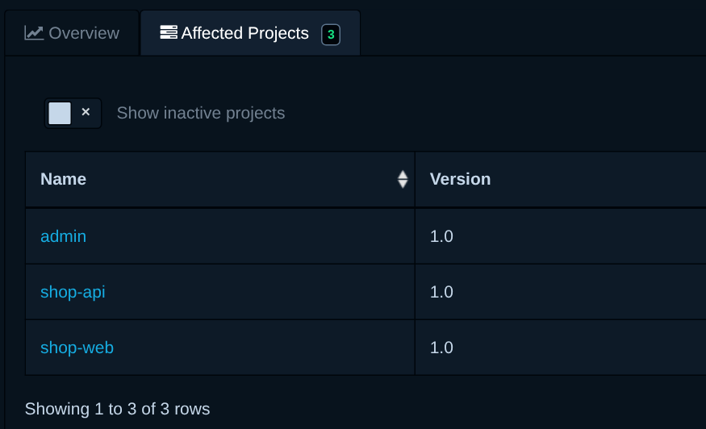
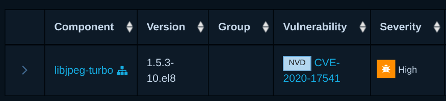

Dependency-Track に SBOM を預けておくと、CVE 番号1つで、その脆弱性が入っているアプリの一覧を画面でも API でも引けます。当たった部品と版も、Dependency-Track が SBOM から突き止めて表示します。

新しい脆弱性の知らせが来るたびにアプリを1つずつ開いて部品を調べ直すと、手間はアプリの数だけ増えます。当たるのはアプリ本体とは限らず、コンテナに入った OS のパッケージのこともあります。

参考動画は記事の最後に紹介しています。

## 環境

- Dependency-Track v5.2.2（2026-11-18 リリース）・PostgreSQL 18（`postgres:18-alpine`）。公式の quickstart の compose をもとに、版を 5.2.2 に固定
- Syft 1.57.2（`-o cyclonedx-json`、既定の CycloneDX 1.7）
- Linux（aarch64）・メモリ 8GB・Docker Compose v2。確認日は 2026-11-21〜22
- 脆弱性データの取り込み元は既定のまま（NVD は有効、OSV・GitHub Advisories・JVN は無効）
- 4本を取り込む間の合計メモリは、いちばん多いときで約 2.1GB でした。NVD を取り込んだ後の PostgreSQL のボリュームは 2.56GB です。どちらも1回の観察値で、必要量ではありません
- NVD は日々更新されるので、後から回すと当たる脆弱性が変わることがあります
- 公式の README では、v4 系は 2026 年 12 月に保守終了予定です。この記事は v5 だけを扱います
- macOS と amd64、定期の解析（既定 24 時間）で照らし直されるところは試していません

## 完成形

API なら GET 1回です。パスの `NVD` は記録の出どころ、最後が CVE 番号です。

```bash
curl -s -H "X-Api-Key: $DT_API_KEY" \
  "http://127.0.0.1:8080/api/v1/vulnerability/source/NVD/vuln/CVE-2020-17541/projects" \
  | grep -o '"name":"[^"]*","version":"[^"]*"' \
  | sed 's/"name":"\([^"]*\)","version":"\([^"]*\)"/\1 \2/'
```

```text
admin 1.0
shop-api 1.0
shop-web 1.0
```

応答は JSON の配列で、要素ごとに `name`・`version`・`active` と、当たった部品の UUID（`affectedComponentUuids`）が入ります。上の `grep` と `sed` は、そこからプロジェクト名と版だけを抜き出しています。サンプルの `scripts/affected.sh` と同じ抜き方で、jq は使っていません（サンプルがホストに求めるのは Docker・git・curl だけです）。

画面なら、左の **Vulnerabilities** → 検索欄に `CVE-2020-17541` → 行を開く → タブ **Affected Projects** の3手です。

預けてあるのは、AlmaLinux 8.4 に古い nginx・PHP・Tomcat・Rails を入れたコンテナ4つの SBOM です。プロジェクト名は業務アプリ風に shop-web（nginx）・shop-api（PHP）・admin（Tomcat）・blog（Rails）としてあります。4本のうち blog だけが出ないのは、この脆弱性に当たる部品が blog に入っていないためです。

## 1. サンプルを起動して API キーを作る

ホストに要るのは Docker（Compose v2 付き）・git・curl です。

```bash
git clone https://github.com/zun-tools/dependency-track-sample
cd dependency-track-sample
docker compose up -d
```

画面は `http://127.0.0.1:8081`、API は `http://127.0.0.1:8080` で開きます。up から API が応答するまで 9〜10 秒でした。

初回のログインは admin / admin で、入るとすぐにパスワードの変更を求められます。API で同じログインを試すと 401 が返り、本文は `FORCE_PASSWORD_CHANGE` です。サンプルの `setup.sh` は、この変更と API キーの作成をまとめて行います。

```bash
export DT_ADMIN_PASSWORD='自分で決めたパスワード'
export DT_API_KEY="$(./scripts/setup.sh)"
```

キーは `odt_` で始まる文字列で、`X-Api-Key` ヘッダで渡します。標準出力に出るだけで、ファイルには書きません。

:::note alert
API キーを持つ Automation チームの既定の権限は `BOM_UPLOAD` と `VIEW_PORTFOLIO` の2つだけです。`setup.sh` は、プロジェクトの自動作成（`PROJECT_CREATION_UPLOAD`）・脆弱性の参照（`VIEW_VULNERABILITY`）・取り込み状況の参照（`SYSTEM_CONFIGURATION_READ`）の3つを足しています。画面で作ったキーを使うときは、Automation チームに同じ3つを足します。場所は Administration > Access Management > Teams です。
:::

## 2. NVD の取り込みを待ってから SBOM を上げる

```bash
./scripts/wait-ready.sh
./scripts/upload.sh
```

Dependency-Track は起動するとすぐに NVD の取り込みを始めます（439,365 件）。`wait-ready.sh` は `GET /api/v2/vuln-data-sources/nvd/mirror-runs/latest` を5秒おきに読み、`status` が `COMPLETED` になったら抜けます。手元の機械と回線では 161 秒と 221 秒でした。

待つのは、解析が走る契機のためです。公式ドキュメントでは、解析は SBOM を上げたとき・手動・定期（既定で、前回の解析から24時間を過ぎたプロジェクト）に走ります。取り込みの途中で上げた SBOM は、その時点でまだ入っていない記録とは、次の解析まで照らされません。上げた後なら、プロジェクトの画面の Reanalyze（手動の解析）で照らし直せます。

:::note alert
`CVE-2020-17541` の行は、NVD の取り込みの途中でも検索に出てきました。番号が引けたことは、取り込みが終わった印になりません。待つ条件は取り込みの状態で見ます。
:::

`upload.sh` は `sbom/` の4本を `POST /api/v1/bom` で上げ、返ってきた `token` を `GET /api/v1/event/token/<token>` で見て、`"processing":false` になるまで待ちます。4本の取り込みは 11〜17 秒で終わりました。1本分の中身は次の形です。

```bash
curl -s -H "X-Api-Key: $DT_API_KEY" \
  -F autoCreate=true -F projectName=shop-web -F projectVersion=1.0 \
  -F bom=@sbom/shop-web.cdx.json \
  "http://127.0.0.1:8080/api/v1/bom"
```

`autoCreate=true` なので、プロジェクトを先に作っておく必要はありません。

自分のアプリで試すなら、Syft で CycloneDX の JSON を作って同じ形で上げます。Dependency-Track が受け付ける SBOM は CycloneDX（JSON・XML）だけです。Syft の既定の CycloneDX 1.7 は、版を指定しないまま取り込めました。

```bash
syft <イメージ名> -o cyclonedx-json > app.cdx.json
```

## 3. CVE 番号で引く

画面の Vulnerabilities で検索欄に `CVE-2020-17541` を打つと、行 `NVD CVE-2020-17541` が1件出ます。Projects 列はすでに 3 で、開く前に影響するプロジェクトの数が分かります。行を開いてタブ Affected Projects に切り替えると、プロジェクト名が並びます。


*Affected Projects のタブ。blog の行はありません*

API で引くなら、完成形の GET です。応答ヘッダの `X-Total-Count` にも件数（ここでは 3）が入ります。サンプルの `./scripts/affected.sh CVE-番号` は同じ GET を包んだもので、番号を省くと `CVE-2020-17541` を引きます。

:::note alert
データに無い番号を渡しても、API は 200 と空の配列を返します。「どのプロジェクトにも当たらない」と「その番号の記録が無い」は、応答だけでは見分けられません。`affected.sh` はどちらの場合も何も出さず、終了コード 1 で終わります。
:::

## 4. どの部品の、どの版で当たったかを見る

プロジェクト shop-web を開き、タブ Audit Vulnerabilities で `CVE-2020-17541` に絞ると、当たった部品の行が出ます。


*shop-web で当たったのは nginx 本体ではなく、部品 libjpeg-turbo 1.5.3-10.el8*

渡したのは番号だけで、部品名は打っていません。libjpeg-turbo は JPEG 画像を読み書きするライブラリで、コンテナに入った AlmaLinux の rpm です。shop-api と admin にも同じ版が入っており、blog の SBOM には jpeg を名前に含む部品が1つもありません。blog が一覧に出ないのはこのためで、blog が安全だという意味ではありません。

照合には CPE（製品の識別子）が使われます。Syft は SBOM の部品に `cpe:2.3:a:libjpeg-turbo:libjpeg-turbo:1.5.3-10.el8:*:*:*:*:*:*:*` を付けています。NVD の記録の範囲は、上流の版で libjpeg-turbo 2.0.4 未満です。Dependency-Track の NVD の照合は、有効な CPE の無い部品を飛ばします。

:::note alert
当たったことは、まだ直っていないこととは限りません。Linux の配布元は、上流の版番号（1.5.3 の部分）を変えずに修正を取り込みます（バックポート）。上流の版で比べる NVD の照合は、直した版にも当たることがあります。同じ libjpeg-turbo 1.5.3-10.el8 には、CVE-2018-14498 も NVD 由来で当たっていました。Red Hat は、この CVE を RHEL 8 の 1.5.3-10.el8 で修正済みとしています。
:::

CVE-2020-17541 のほうは、配布元の修正版が 1.5.3-12.el8 です（AlmaLinux の ALSA-2021:4288）。サンプルの 1.5.3-10.el8 は、それより前の版です。一覧は「どこを見に行くか」の答えで、直すかどうかは配布元の勧告で確かめてから決めます。

## 5. 番号で出てこないときは、画面の Components で部品の名前から引く

CVE 番号で引けたのは、NVD 由来の記録だけでした。OSV（AlmaLinux など）を有効にすると、AlmaLinux の記録は `ALSA-2021:4288` のような勧告の ID で入り、CVE の別名は付いていませんでした。OSV の設定 Alias Synchronization Enabled は既定の off のままでした。on にすれば CVE 番号で引けるかは確かめていません。

出たばかりの CVE も、番号で当たらないことがあります。NIST は 2026-04-15 に、優先の基準に当たらない CVE には製品の情報（CPE）を直ちには付けないと公表しました。CPE が付くまでは、取り込みと解析が済んでも NVD の照合で当たらないことがあります。

そのあいだは、速報や勧告に書かれた部品の名前で引けます。こちらは画面で行う手で、左の **Components** で、Name に `libjpeg-turbo`、Version に `1.5.3` の条件を付けます。libjpeg-turbo 1.5.3-10.el8 の3行が出ました。Project Name 列には shop-api 1.0・admin 1.0・shop-web 1.0 が並びます。Syft の SBOM には、rpm などのパッケージのほかに、purl の無いファイルも部品（component）として入っています。shop-web の SBOM では、9,933 件のうち 9,703 件が purl の無い部品でした。Name だけで絞ったときは、こうしたファイルの部品（文書ファイル）も並び、Version の条件を足すと消えました。

## 使った道具について

Dependency-Track は OWASP のプロジェクトで、Apache-2.0 の OSS です。自分の機械でサーバー（画面と API）を動かし、預かった SBOM の部品を脆弱性の公開データと照らします。公式ドキュメントでは、定期の解析によって、最後に上げた後に公開された脆弱性も、SBOM を上げ直さずに finding になります。部品を変えたときは、SBOM を上げ直します。

Syft は Anchore の OSS で、コンテナのイメージやファイルシステムから SBOM を作ります。

## まとめ

| 症状 | 対処 |
|---|---|
| 新しい CVE のたびに、アプリを1つずつ開いて調べ直している | SBOM を Dependency-Track に預け、`/api/v1/vulnerability/source/NVD/vuln/<CVE>/projects` か画面の Affected Projects で引く |
| 一覧に出たアプリの、どこを直せばよいか分からない | プロジェクトの Audit Vulnerabilities で、当たった部品と版を見る |
| 当たった版が、配布元ではもう直っているかもしれない | 配布元の勧告の修正版と比べる（NVD の照合は上流の版で比べる） |
| NVD の取り込みの途中で SBOM を上げてしまった | 次からは取り込み完了（`mirror-runs/latest` の `COMPLETED`）を待って上げる。上げた分は Reanalyze で照らし直す |
| 番号で 0 件、または出たばかりの CVE | 0 件を「入っていない」と読まず、画面の Components で部品の名前と版で引く |

## 参考リンク

- [Dependency-Track: Quickstart](https://dependencytrack.github.io/docs/tutorials/quickstart/)
- [Dependency-Track: Vulnerability findings（解析が走る契機と既定の間隔）](https://dependencytrack.github.io/docs/concepts/vulnerability-findings/)
- [Red Hat: Backporting Security Fixes](https://access.redhat.com/security/updates/backporting)
- [NIST: National Vulnerability Database（2026-04-15 の運用変更の告知）](https://www.nist.gov/itl/nvd)
- [サンプル: zun-tools/dependency-track-sample（compose.yaml・sbom/・scripts/）](https://github.com/zun-tools/dependency-track-sample)

## 参考動画

<iframe width="560" height="315" src="https://www.youtube.com/embed/Q0fqTyivUQA" title="YouTube video player" frameborder="0" allowfullscreen></iframe>
