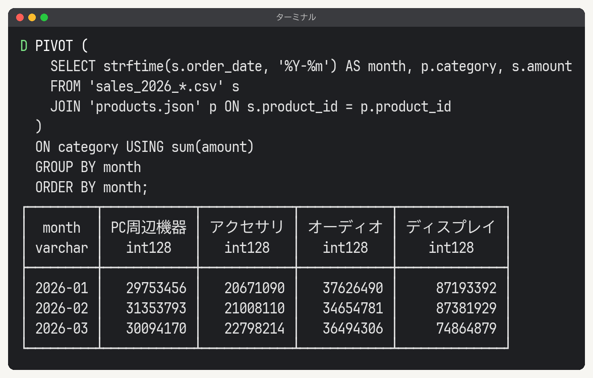
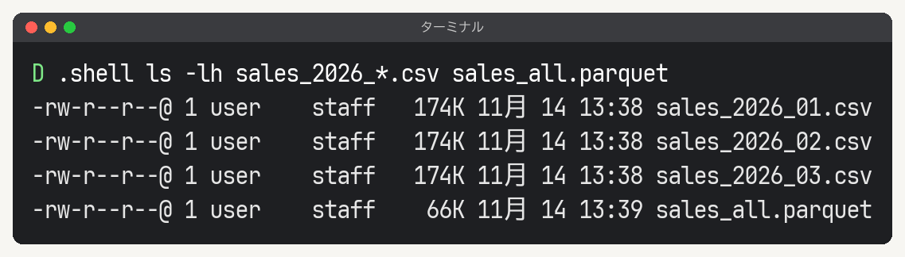

月ごとに増える売上の CSV を Excel に貼り合わせたり、集計のたびに使い捨てのスクリプトを書いたりしていないでしょうか。
DuckDB では、3か月分の CSV（計 6,000 行）と商品一覧の JSON を、表を作らず取り込みもせずに SQL 1本でつないで集計できました。Parquet 1本に変えると 522KB が 66KB になり、件数と合計はそのまま一致しています。一方、Shift_JIS の CSV は `encoding` を指定するだけでは読めず、拡張を1つ入れる必要がありました。
手元の CSV を1本選び、`duckdb -c "SUMMARIZE 'ファイル名.csv';"` を打つところから始められます。導入は `brew install duckdb` の1行です（手順は後半）。

:::note info
動画では、サーバーへつなぐふつうのデータベースと、打ったコマンドの中で動く DuckDB を、図で並べて見比べられます（00:59 から約20秒）。
:::

<iframe width="560" height="315" src="https://www.youtube.com/embed/C-XYBog9rM4" title="YouTube video player" frameborder="0" allowfullscreen></iframe>

## DuckDB は、打ったコマンドの中で動く分析用のデータベース

ふつうのデータベースは、先に立てたサーバーへつないで使います。DuckDB はサーバーを持たず、`duckdb` と打ったそのプロセスの中で動きます。公式の「Why DuckDB」はこう書いています。

> there is no DBMS server software to install, update, and maintain.
> （インストールし、更新し、保守するデータベースのサーバーのソフトが無い）

もう1つの特徴は、`FROM` の後ろにファイル名をそのまま書ける点です。CSV・JSON・Parquet を、表の定義も取り込みの手順も無しに読めます。CSV の区切りや列の型は、中身を見て自動で推論されます。表を作って取り込んでから SQL を書く、ふつうの手順と並べた図は、動画の [02:13 から](https://youtu.be/C-XYBog9rM4?t=133) にあります。

## 手元のファイルにそのまま SQL を当てた結果

架空のガジェット店の売上データで試した結果です。同じデータは次の節のスクリプトで作れます。

| やったこと | 要の書き方 | 結果 |
|---|---|---|
| CSV 3本をまとめて読む | `FROM 'sales_2026_*.csv'` | 6,000 行・売上合計 513,894,610 |
| JSON の商品一覧とつなぐ | `JOIN 'products.json'` | カテゴリ・商品別の5行 |
| 全列の中身を一度に見る | `SUMMARIZE` | 9列の型・最小・最大・欠けの割合 |
| 月×カテゴリの表にする | `PIVOT ... ON category` | 3か月×4カテゴリ |
| Parquet 1本に変える | `COPY ... (FORMAT parquet)` | 522KB → 66KB・件数と合計が一致 |
| Shift_JIS の CSV を読む | `INSTALL encodings` | 日本語の3行 |
| 「N/A」「未定」が混じった CSV | `nullstr` | 100 行・合計 2,352,000 |

この記事の手順では、`CREATE TABLE` を一度も打っていません。

## 手元で試す：入れて、サンプルのデータを作る

Mac なら Homebrew の1行で入ります。

```bash
brew install duckdb
```

Linux と macOS は、公式のインストールスクリプト `curl https://install.duckdb.org | bash` でも入ります。Windows は公式のインストールのページを見てください。アカウントや設定ファイルは要りません。

データはサンプルのスクリプトで作ります。Python 3 の標準ライブラリだけで動き、乱数の種を固定しているので、件数と合計はこの記事と同じになります。

```bash
git clone https://github.com/zun-tools/duckdb-sample.git
mkdir duckdb-trial && cd duckdb-trial
python3 ../duckdb-sample/gen_sample.py
duckdb
```

最後の `duckdb` で対話の画面に入り、プロンプトが `D` になります。以降の SQL はこの中で打ちます。ファイル名を付けずに開いたので、これはメモリ上の一時的なデータベースで、閉じると消えます。作った表を残したいときは `duckdb ファイル名.db` で開くと、その1ファイルに残ります。サンプルの `queries.sql` に、この記事の SQL が同じ順で並んでいます。

<details><summary>確認環境と、試していないこと</summary>

- 確認日は 2026-11-14。macOS（Apple シリコン）で、Homebrew で入れた CLI の DuckDB v2.0.0 (Cyanoptera) d54cbbe3df
- 数字はすべて、このサンプルデータで1回ずつ実行した値です。Parquet の縮み方はデータによって変わります
- 速さは測っていません。ほかの道具との比較もしていません
- Linux と Windows では試していません
- `duckdb -ui` で開くブラウザの画面は試していません。公式の説明では、初回に拡張のダウンロードが要ります

</details>

## CSV と JSON を、取り込まずに読んでつなぐ

### 1本の CSV を読む

```sql
SELECT order_id, order_date, product_id, quantity, amount FROM 'sales_2026_01.csv' LIMIT 5;
```

```text
┌──────────────────┬────────────┬────────────┬──────────┬────────┐
│     order_id     │ order_date │ product_id │ quantity │ amount │
│     varchar      │    date    │  varchar   │  int64   │ int64  │
├──────────────────┼────────────┼────────────┼──────────┼────────┤
│ ORD-2026_01-0001 │ 2026-01-30 │ P001       │        2 │  29720 │
│ ORD-2026_01-0002 │ 2026-01-08 │ P001       │        4 │  62196 │
│ ORD-2026_01-0003 │ 2026-01-18 │ P004       │        5 │ 151605 │
│ ORD-2026_01-0004 │ 2026-01-05 │ P003       │        2 │ 134526 │
│ ORD-2026_01-0005 │ 2026-01-10 │ P002       │        4 │  45660 │
└──────────────────┴────────────┴────────────┴──────────┴────────┘
```

列名の下の行が、DuckDB が推論した型です。日付は `date`、数量と金額は整数の `int64` として読まれています。

### `*` で3か月分をまとめて読む

ファイル名の月の部分を `*` にすると、一致するファイルを全部まとめて1つの表として読みます。

```sql
SELECT count(*) AS total_rows, sum(amount) AS total_sales FROM 'sales_2026_*.csv';
```

```text
┌────────────┬─────────────┐
│ total_rows │ total_sales │
│   int64    │   int128    │
├────────────┼─────────────┤
│       6000 │   513894610 │
└────────────┴─────────────┘
```

`sales_2026_*.csv` は、2026年のどの月のファイルにも一致します。いまフォルダにあるのが1〜3月の3本なので3か月分になりました。4月分を同じフォルダに置けば、それも読まれます。月を絞りたいときは、ファイル名を具体的に書くか、`WHERE` で `order_date` を絞ります。

### JSON の配列と入れ子を取り出す

`products.json` の1件は、次の形です。タグは配列で、電池の持ちは `spec` の中に入れ子になっています。

```json:products.json（先頭の1件）
  {
    "product_id": "P001",
    "name": "メカニカルキーボード 60%",
    "category": "PC周辺機器",
    "base_cost": 12000,
    "tags": [
      "ハードウェア",
      "人気",
      "静音赤軸"
    ],
    "spec": {
      "switch": "silent-red",
      "wireless": true,
      "battery_hours": 40
    }
  },
```

JSON も `FROM` に書くだけです。配列は `tags[1]` のように番号で（1始まり）、入れ子は `spec.battery_hours` のように点でつないで取り出せます。

```sql
SELECT product_id, name, category, tags[1] AS first_tag, spec.battery_hours AS battery FROM 'products.json';
```

```text
┌────────────┬──────────────────────────────────┬──────────────┬──────────────┬─────────┐
│ product_id │               name               │   category   │  first_tag   │ battery │
│  varchar   │             varchar              │   varchar    │   varchar    │  int64  │
├────────────┼──────────────────────────────────┼──────────────┼──────────────┼─────────┤
│ P001       │ メカニカルキーボード 60%         │ PC周辺機器   │ ハードウェア │      40 │
│ P002       │ トラックボールマウス             │ PC周辺機器   │ ハードウェア │     120 │
│ P003       │ ウルトラワイドモニター 34型      │ ディスプレイ │ 大型         │    NULL │
│ P004       │ ノイズキャンセリングヘッドセット │ オーディオ   │ マイク       │    NULL │
│ P005       │ USB-C デスク用ドック 12-in-1     │ アクセサリ   │ ハブ         │    NULL │
└────────────┴──────────────────────────────────┴──────────────┴──────────────┴─────────┘
```

`battery_hours` を持たない商品（モニターなど）は `NULL` になります。

### CSV 3本と JSON を JOIN する

売上の行には商品 ID しかありません。商品 ID で JSON とつなぐと、行ごとに商品名とカテゴリが付きます。

```sql
SELECT p.category, p.name,
       count(s.order_id) AS order_count,
       sum(s.quantity)   AS total_qty,
       sum(s.amount)     AS total_revenue
FROM 'sales_2026_*.csv' s
JOIN 'products.json' p ON s.product_id = p.product_id
GROUP BY p.category, p.name
ORDER BY total_revenue DESC;
```

```text
┌──────────────┬──────────────────────────────────┬─────────────┬───────────┬───────────────┐
│   category   │               name               │ order_count │ total_qty │ total_revenue │
│   varchar    │             varchar              │    int64    │  int128   │    int128     │
├──────────────┼──────────────────────────────────┼─────────────┼───────────┼───────────────┤
│ ディスプレイ │ ウルトラワイドモニター 34型      │        1177 │      3513 │     249440200 │
│ オーディオ   │ ノイズキャンセリングヘッドセット │        1214 │      3699 │     108775577 │
│ アクセサリ   │ USB-C デスク用ドック 12-in-1     │        1161 │      3510 │      64477414 │
│ PC周辺機器   │ メカニカルキーボード 60%         │        1263 │      3735 │      54958049 │
│ PC周辺機器   │ トラックボールマウス             │        1185 │      3489 │      36243370 │
└──────────────┴──────────────────────────────────┴─────────────┴───────────┴───────────────┘
```

形式の違う4つのファイルが、貼り合わせ無しで1枚の表になりました。

## 中身を探って、短い SQL でまとめる

DuckDB には、手で探るときに書く量を減らす独自の構文があり、公式は「Friendly SQL」と呼んでいます。

### `FROM` から書く・`DESCRIBE`・`SUMMARIZE`

```sql
FROM 'sales_2026_01.csv' LIMIT 3;
DESCRIBE FROM 'sales_2026_01.csv';
SUMMARIZE 'sales_2026_01.csv';
```

1行目は `SELECT *` を省いた形で、全列が出ます。`DESCRIBE` は列名と型だけを並べます。

初めて見る CSV に最初に当てるなら `SUMMARIZE` です。全部の列について、型・最小・最大・おおよその種類数・平均・分位点・件数・`NULL` の割合を1回で返します。出力は12列と横に長いので、ここでは一部を抜き出しました。

| column_name | column_type | min | max | null_percentage |
|---|---|---|---|---|
| order_date | DATE | 2026-01-01 | 2026-01-31 | 0.00 |
| quantity | BIGINT | 1 | 5 | 0.00 |
| amount | BIGINT | 9458 | 390990 | 0.00 |
| note | VARCHAR | ギフト包装 | 通常発送 | 16.35 |

見る所は `column_type` です。`BIGINT` は整数で、最初の出力の `int64` と同じ型です。`VARCHAR` は文字の列を表します。数字の列が `VARCHAR` になっていれば、集計の前にここで気づけます。備考の `note` は 16.35% が空で、欠けている列も先に分かります。

### `GROUP BY ALL` でまとめる列を書かない

```sql
SELECT customer_type, product_id, count(*) AS count, sum(amount) AS total_amount
FROM 'sales_2026_01.csv'
GROUP BY ALL
ORDER BY total_amount DESC
LIMIT 5;
```

```text
┌───────────────┬────────────┬───────┬──────────────┐
│ customer_type │ product_id │ count │ total_amount │
│    varchar    │  varchar   │ int64 │    int128    │
├───────────────┼────────────┼───────┼──────────────┤
│ プレミアム    │ P003       │   103 │     22769168 │
│ ゲスト        │ P003       │   107 │     22528947 │
│ 法人          │ P003       │   102 │     21935642 │
│ 一般会員      │ P003       │    91 │     19959635 │
│ ゲスト        │ P004       │   118 │     10597135 │
└───────────────┴────────────┴───────┴──────────────┘
```

`GROUP BY ALL` は、`SELECT` に並んだ集計でない列（ここでは `customer_type` と `product_id`）を、まとめる列として推論します。

### `PIVOT` で月×カテゴリの表にする

月とカテゴリの組み合わせを縦に並べると12行になり、見比べにくくなります。`PIVOT` で、カテゴリを列に回します。

```sql
PIVOT (
  SELECT strftime(s.order_date, '%Y-%m') AS month, p.category, s.amount
  FROM 'sales_2026_*.csv' s
  JOIN 'products.json' p ON s.product_id = p.product_id
)
ON category USING sum(amount)
GROUP BY month
ORDER BY month;
```


*右端のディスプレイの列だけ、3月が2月より約1,250万円少ない。ほかの3列は大きく動いていない*

`ON` に横へ並べる列、`USING` に升目に入れる集計を書きます。括弧の中は、前の節の JOIN とほぼ同じ文です。

## Parquet に変えて軽く残す

同じ見比べを何度もするなら、CSV 3本を1本にまとめて残しておくと扱いやすくなります。Parquet は、列ごとにまとめて圧縮して保存するファイル形式です。

```sql
COPY (FROM 'sales_2026_*.csv')
  TO 'sales_all.parquet' (FORMAT parquet, COMPRESSION zstd);
```

成功しても何も表示されません。列には手を付けず、CSV の9列をそのまま書き出しています。圧縮は zstd を指定しました。指定しないときの既定は Snappy です。

大きさは、対話の画面から `.shell` でシェルのコマンドを走らせて確かめられます。

```sql
.shell ls -lh sales_2026_*.csv sales_all.parquet
```


*CSV は 174K が3本、Parquet は 66K の1本*

174K が3本で約522KB、Parquet は 66KB でした。バイト数では 535,130 から 67,968 で、このデータでは約8分の1です。

中身が変わっていないかは、両方に同じ集計を当てて確かめます。

```sql
SELECT count(*), sum(amount) FROM 'sales_all.parquet';
SELECT count(*), sum(amount) FROM 'sales_2026_*.csv';
```

どちらも 6,000 行・513,894,610 で一致しました。変えた後も、`FROM 'sales_all.parquet'` と書けば同じ書き方で集計できます。

## 読めない CSV を直して読む

### Shift_JIS は `encodings` 拡張を入れる

Shift_JIS の CSV は、そのままでは読めません。

```sql
FROM 'sales_sjis.csv';
```

```text
Invalid Input Error: CSV Error on Line: 1
Invalid unicode (byte sequence mismatch) detected. This file is not utf-8 encoded.
```

UTF-8 ではないというエラーです。文字コードを指定しても、拡張が無いと別のエラーになります。

```sql
FROM read_csv('sales_sjis.csv', encoding = 'shift_jis');
```

```text
Invalid Input Error: The CSV Reader does not support the encoding: "shift_jis"
It is possible that the encoding exists in the encodings extension. You can try "INSTALL encodings; LOAD encodings"
The currently supported encodings are: 
*  utf-16
*  latin-1
*  utf-8
```

CSV の読み込みが標準で対応する文字コードは、UTF-8・UTF-16・Latin-1 の3つだけです。DuckDB には、拡張を必要なときに自動で読み込む設定（自動ロード）があります。その設定を既定のままにしていても、拡張を一度も入れていない状態では、このエラーになりました。エラー文が次の手を示しているので、そのとおりに打ちます。

```sql
INSTALL encodings; LOAD encodings;
FROM read_csv('sales_sjis.csv', encoding = 'shift_jis');
```

```text
┌──────────┬────────────────────────────┬─────────┬───────┐
│ 注文番号 │           商品名           │  区分   │ 金額  │
│ varchar  │          varchar           │ varchar │ int64 │
├──────────┼────────────────────────────┼─────────┼───────┤
│ S001     │ 日本語メカニカルキーボード │ 通販    │ 15000 │
│ S002     │ 静音マウスパッド           │ 店舗    │  2500 │
│ S003     │ 有線LANアダプタ            │ 法人    │  3800 │
└──────────┴────────────────────────────┴─────────┴───────┘
```

`encodings` は公式の拡張で、`INSTALL` でダウンロードし、`LOAD` でそのセッションに読み込みます。初回はネットにつながっている必要がありますが、登録は要りません。

### 数字の列に文字が混じったら `nullstr`

サンプルの `sales_corrupted.csv` は、単価と金額の列に「N/A」や「未定」が混じった 100 行です。`SUMMARIZE` を当てると、2つの列が文字の列として読まれていました（出力の一部）。

| column_name | column_type | min | max |
|---|---|---|---|
| unit_price | VARCHAR | 12000 | 未定 |
| amount | VARCHAR | 24000 | 未定 |

文字として並べるので、最大が「未定」になります。このまま `sum(amount)` を取ると、文字の列に使える `sum` が無いというエラーになります。

```text
Binder Error: No function matches the given name and argument types 'sum(VARCHAR)'. You might need to add explicit type casts.
```

`read_csv` の `nullstr` に、空とみなす文字を渡します。

```sql
DESCRIBE FROM read_csv('sales_corrupted.csv', nullstr = ['N/A', '未定']);
SELECT count(*) AS rows, sum(amount) AS total
FROM read_csv('sales_corrupted.csv', nullstr = ['N/A', '未定']);
```

`DESCRIBE` で `unit_price` と `amount` が `bigint` に戻り、集計は 100 行・合計 2,352,000 になりました。崩れていたのは 100 行のうち2行で、金額が「N/A」の行と、単価も金額も「未定」の行です。この2行の金額は `NULL` になり、合計には入りません。

このデータは `nullstr` だけで直りました。それで直らない CSV は、`read_csv` の `columns` で列の型も指定します。

## DuckDB の素性

オランダの研究所 CWI の Mark Raasveldt と Hannes Mühleisen が作った、MIT ライセンスの OSS です。公式は、SQLite の「入れるのが簡単で、アプリの中で動く」考えを分析向けに取り入れた、と説明しています。2026年には開発会社の DuckLabs が AWS に加わりました。FAQ によれば、知財は非営利の DuckDB Foundation に残り、OSS のまま続きます。

v2.0.0 は 2026年10月21日に公開された長期サポート版です。

> DuckDB 2.0 is a long-term support (LTS) release with support until at least October 2027.
> （DuckDB 2.0 は長期サポート（LTS）版で、少なくとも2027年10月までサポートされる）

## まとめ

- DuckDB はサーバーを持たず、打ったコマンドの中で動く。`FROM` にファイル名を書けば、CSV・JSON・Parquet をそのまま読める
- `*` で複数の CSV をまとめて読み、JSON と JOIN できた。`*` は一致するファイルを全部読むので、絞るならファイル名か `WHERE` で
- `SUMMARIZE` で全列の型と欠けを先に見て、`GROUP BY ALL` と `PIVOT` で短くまとめられる
- `COPY` 1文で Parquet に変えると、このデータでは 522KB が 66KB になり、件数と合計は一致した
- Shift_JIS は `encodings` 拡張を入れて読む。数字の列が `VARCHAR` になったら `nullstr` を試す

今回のサンプルでは、表を作る手順も前処理のスクリプトも書かずに、読む・探る・まとめる・変えて残すまでを SQL だけで通せました。まずは手元の CSV を1本選び、`duckdb -c "SUMMARIZE 'ファイル名.csv';"` で数字の列が数字として読まれているかを確かめてみてください。

---

動画で見たい方はこちら → [【DuckDB入門】CSVとJSONを取り込まずにSQLで集計、Parquetで軽く残す](https://youtu.be/C-XYBog9rM4)（図は 00:59〜）

## 参考リンク（一次情報）

- [DuckDB 公式サイト](https://duckdb.org/)
- [Why DuckDB（サーバーが要らない理由・SQLite との関係）](https://duckdb.org/why_duckdb)
- [FAQ（ライセンス・作り手・財団）](https://duckdb.org/faq)
- [DuckDB 2.0.0 の発表（LTS）](https://duckdb.org/2026/10/21/announcing-duckdb-200.html)
- [インストール](https://duckdb.org/docs/2.0/installation.html)
- [複数ファイルを読む（glob）](https://duckdb.org/docs/2.0/data/multiple_files/overview.html)
- [JSON を読む](https://duckdb.org/docs/2.0/data/json/overview.html)
- [Friendly SQL](https://duckdb.org/docs/2.0/sql/dialect/friendly_sql.html)
- [SUMMARIZE](https://duckdb.org/docs/2.0/guides/meta/summarize.html)
- [PIVOT](https://duckdb.org/docs/2.0/sql/statements/pivot.html)
- [Parquet（COPY・圧縮の既定）](https://duckdb.org/docs/2.0/data/parquet/overview.html)
- [CSV の読み込み（encoding・nullstr・columns）](https://duckdb.org/docs/2.0/data/csv/overview.html)
- [encodings 拡張](https://duckdb.org/docs/2.0/core_extensions/encodings.html)
- [INSTALL と LOAD](https://duckdb.org/docs/2.0/sql/statements/load_and_install.html)
- [CLI の dot commands（.shell）](https://duckdb.org/docs/2.0/clients/cli/dot_commands.html)
- [duckdb/duckdb（公式リポジトリ）](https://github.com/duckdb/duckdb)
- [サンプル: zun-tools/duckdb-sample（gen_sample.py・queries.sql）](https://github.com/zun-tools/duckdb-sample)
