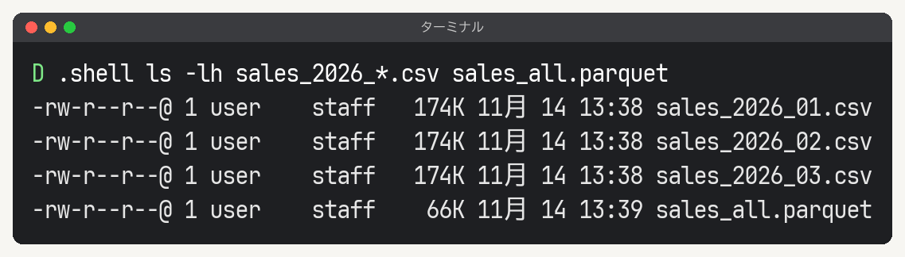

DuckDB の `COPY` 文を使うと、複数の CSV ファイルを zstd で圧縮した Parquet 1本にまとめて書き出せます。同じ集計を何度も回すときに、読み込むファイルの数と容量を減らせます。

参考動画は記事の最後に紹介しています。

## 環境

- DuckDB v2.0.0 (Cyanoptera) d54cbbe3df（CLI。Homebrew で導入）
- macOS（Apple シリコン）
- 確認日は 2026-11-14。Linux と Windows では試していません
- サンプルデータの生成に Python 3（標準ライブラリだけ）
- Parquet の縮み方はデータによって変わります

## 完成形

```sql
COPY (FROM 'sales_2026_*.csv')
  TO 'sales_all.parquet' (FORMAT parquet, COMPRESSION zstd);
```

複数の CSV をそのまま 1本の Parquet ファイルへ書き出す文です。ファイル名を手元のものに合わせれば使えます。

## 1. DuckDB を入れて、サンプルのデータを作る

Mac なら Homebrew の1行で入ります。

```bash
brew install duckdb
```

Linux と macOS は、公式のインストールスクリプト `curl https://install.duckdb.org | bash` でも入ります。Windows は公式のインストールのページを見てください。アカウントや設定ファイルは要りません。

データは架空のガジェット店の売上で、サンプルのスクリプトで作ります。乱数の種を固定しているので、件数と合計はこの記事と同じになります。

```bash
git clone https://github.com/zun-tools/duckdb-sample.git
mkdir duckdb-trial && cd duckdb-trial
python3 ../duckdb-sample/gen_sample.py
duckdb
```

月ごとの売上 `sales_2026_01.csv`〜`sales_2026_03.csv`（計 6,000 行）などができます。最後の `duckdb` で対話の画面に入り、プロンプトが `D` になります。以降の SQL はこの中で打ちます。

## 2. `COPY` で Parquet 1本に書き出す

Parquet は、列ごとにまとめて圧縮して保存するファイル形式です。`FROM 'sales_2026_*.csv'` の `*` は、一致するファイルを全部まとめて1つの表として読む書き方です。

```sql
COPY (FROM 'sales_2026_*.csv')
  TO 'sales_all.parquet' (FORMAT parquet, COMPRESSION zstd);
```

成功しても何も表示されません。CSV の9列をそのまま、zstd で圧縮して書き出しています（指定しないときの既定は Snappy）。

## 3. ファイルの大きさを確かめる

大きさは、対話の画面から `.shell` でシェルのコマンドを走らせて確かめられます。

```sql
.shell ls -lh sales_2026_*.csv sales_all.parquet
```


*CSV は 174K が3本、Parquet は 66K の1本*

174K が3本で約522KB、Parquet は 66KB の1本になり、このデータでは約8分の1です。

## 4. 件数と合計が CSV と一致するか確かめる

中身が変わっていないかは、両方に同じ集計を当てて確かめます。

```sql
SELECT count(*), sum(amount) FROM 'sales_all.parquet';
SELECT count(*), sum(amount) FROM 'sales_2026_*.csv';
```

どちらも 6,000 行・513,894,610 で一致しました。変えた後も、`FROM 'sales_all.parquet'` と書けば、CSV と同じ書き方で集計できます。

## DuckDB について

DuckDB はサーバーを持たず、`duckdb` と打ったそのプロセスの中で動く分析用のデータベースです。`FROM` の後ろに CSV・JSON・Parquet のファイル名を書けば、表の定義も取り込みの手順も無しに読めます。

## まとめ

- 繰り返し使う CSV は `COPY ... (FORMAT parquet, COMPRESSION zstd)` で1本の Parquet に書き出せる
- このデータでは 174K が3本（約522KB）から 66KB（約8分の1）になり、件数（6,000 行）と合計（513,894,610）は一致した
- 書き出した後は `FROM 'sales_all.parquet'` でそのまま集計できる

## 参考リンク

- [Parquet（COPY・圧縮の既定）](https://duckdb.org/docs/2.0/data/parquet/overview.html)
- [サンプル: zun-tools/duckdb-sample（gen_sample.py・queries.sql）](https://github.com/zun-tools/duckdb-sample)

## 参考動画

<iframe width="560" height="315" src="https://www.youtube.com/embed/C-XYBog9rM4" title="YouTube video player" frameborder="0" allowfullscreen></iframe>

---

シリーズの他の記事: https://qiita.com/zundamon-tools/private/3dba4f8a2dfca9ddee79
