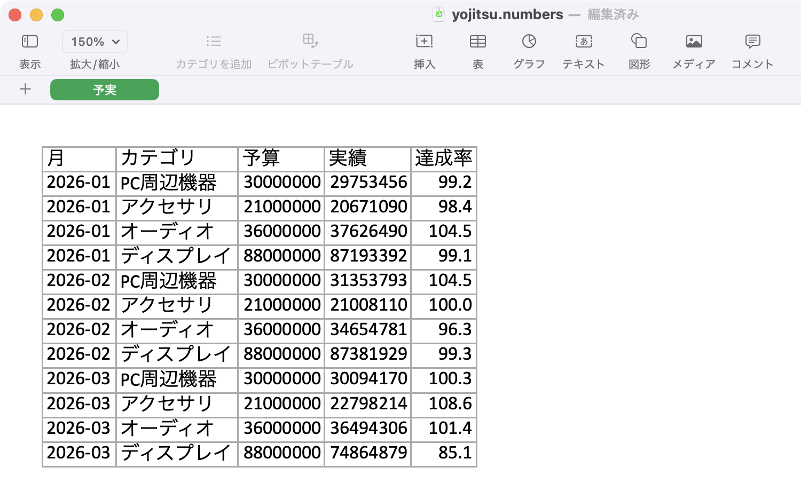

DuckDB の excel 拡張を使うと、届いた Excel のファイル（xlsx）を `FROM` で読めます。手元の CSV・JSON と1本の SQL で突き合わせ、結果を `COPY` で xlsx に書き出すところまで SQL だけで済みます。上に表題や空行がある xlsx も、`read_xlsx` の `range` で見出しの行から読めます。

届いた Excel を SQL で扱おうとすると、表計算ソフトで CSV に保存し直す手間が挟まります。集計した結果を Excel で返すときも、結果を貼り直す作業が残ります。人が作った Excel には1行目に表題・2行目に空行を置いた表もあり、そのまま読むと0行の表にしかなりません。

参考動画は記事の最後に紹介しています。

## 環境

- DuckDB v2.0.1 (Cyanoptera) 8d78114e90（公式の CLI）・Linux（aarch64）
- `LOAD` が要るかどうかは、macOS（Apple シリコン）の v2.0.0 (Cyanoptera) d54cbbe3df でも同じ結果
- 書き出した xlsx を開いて確かめたのは macOS の Numbers 14.4 で、Excel では開いていません
- 確認日は 2026-11-22。Windows では試していません
- サンプルデータの生成に Python 3（標準ライブラリだけ）

## 完成形

```sql
INSTALL excel; LOAD excel;

COPY (
  SELECT b.月, b.カテゴリ, b.予算,
         sum(s.amount) AS 実績,
         round(sum(s.amount) / b.予算 * 100, 1) AS 達成率
  FROM read_xlsx('budget.xlsx', range = 'A3:C15') b
  JOIN 'products.json' p ON p.category = b.カテゴリ
  JOIN 'sales_2026_*.csv' s ON s.product_id = p.product_id
                           AND strftime(s.order_date, '%Y-%m') = b.月
  GROUP BY b.月, b.カテゴリ, b.予算
  ORDER BY b.月, b.カテゴリ
) TO 'yojitsu.xlsx' (FORMAT xlsx, HEADER true, SHEET '予実');
```

3行目が見出しの予算の xlsx を、売上の CSV・商品の JSON とつなぎます。月×カテゴリの予算・実績・達成率を、シート「予実」の xlsx に書き出す文です。

使う列は、予算の xlsx の「月・カテゴリ・予算」、売上の CSV の注文日 `order_date`・商品 ID `product_id`・金額 `amount`、商品の JSON の商品 ID `product_id`・カテゴリ `category` です。ファイル名・範囲・列名は手元のものに合わせてください。

:::note alert
CSV と違い、xlsx は `*`（glob）でまとめて読めませんでした。月ごとの `m_2026_01.xlsx`・`m_2026_02.xlsx` を `read_xlsx('m_2026_*.xlsx')` で指すと、エラーは出ずに1ファイル目の行だけが返ります。
:::

## 1. DuckDB を入れて、データを用意する

Mac なら Homebrew の1行で入ります。

```bash
brew install duckdb
```

Linux と macOS は、公式のインストールスクリプト `curl https://install.duckdb.org | bash` でも入ります。Windows は公式のインストールのページを見てください。

データは架空のガジェット店の売上と予算で、サンプルのリポジトリから用意します。

```bash
git clone https://github.com/zun-tools/duckdb-sample.git
mkdir duckdb-trial && cd duckdb-trial
python3 ../duckdb-sample/gen_sample.py
cp ../duckdb-sample/budget.xlsx .
duckdb
```

`gen_sample.py` が月ごとの売上 `sales_2026_01.csv`〜`sales_2026_03.csv`（計 6,000 行）と商品一覧の `products.json` を作ります。乱数の種を固定しているので、件数と合計はこの記事と同じになります。

- 売上の CSV（9列）: 注文番号 `order_id`・注文日 `order_date`・商品 ID `product_id`・数量 `quantity`・金額 `amount`・顧客区分 `customer_type` など
- 商品一覧の JSON: 商品 ID `product_id`・商品名 `name`・カテゴリ `category` など

`budget.xlsx` は営業部から届いた体の予算です。シート「予算」の1行目に表題、2行目は空行、3行目に見出し「月・カテゴリ・予算」があり、4〜15行目に月×カテゴリの12行が入っています。最後の `duckdb` で対話シェルが起動し、プロンプトが `D` に変わります。

## 2. 表題つきの xlsx をそのまま読むと0行になる

読むだけなら、CSV と同じく `FROM` の後ろにファイル名を書けば読めます。`LOAD excel;` を打っていなくても読めました。

```sql
FROM 'budget.xlsx';
```

| 2026年 第1四半期 カテゴリ別予算（営業部）<br>varchar |
|---|

結果は表題を列名にした1列で、行は0です。範囲を指定しない読み込みは、空でないセルが続く最初の行から、最初の空行までを表とみなします。1行目の表題が見出しの扱いになり、2行目の空行で読み終えたことになります。

## 3. `range` で見出しの行から読む

```sql
FROM read_xlsx('budget.xlsx', range = 'A3:C15');
```

| 月<br>varchar | カテゴリ<br>varchar | 予算<br>double |
|---|---|--:|
| 2026-01 | PC周辺機器 | 30000000.0 |
| 2026-01 | アクセサリ | 21000000.0 |
| 2026-01 | オーディオ | 36000000.0 |
| 2026-01 | ディスプレイ | 88000000.0 |

12 行のうち、先頭の4行です。`range` にはセル番地で範囲を渡します。`A3:C15` は A列3行目から C列15行目までで、3行目の見出しが列名になりました。オプションを渡すときは、`FROM 'ファイル名'` ではなく `read_xlsx(...)` の形で書きます。

予算が `88000000.0` と小数で出るのは、xlsx を読むと数値の列が `DOUBLE` に推論されるためです。文字列の列は `VARCHAR` になります。例外は日付・時刻・真偽値で、セルの表示形式から `DATE` などに推論されます。

範囲の終わりの行は省かずに書きます。終わりを省いた `A3:C` は、シートの最終行までを表として読みます。

```sql
SELECT count(*) AS rows, count(予算) AS non_null
FROM read_xlsx('budget.xlsx', range = 'A3:C');
```

```text
┌─────────┬──────────┐
│  rows   │ non_null │
│  int64  │  int64   │
├─────────┼──────────┤
│ 1048573 │       12 │
└─────────┴──────────┘
```

予算が入っているのは12行だけで、残りの百万行余りは NULL の行です。終わりの行が決まらない表なら、`stop_at_empty = true` を足すと空行で止まり、12行になりました。

## 4. 予算・売上・商品を1本の SQL で突き合わせる

予算は「月×カテゴリ」の表で、売上の CSV は注文ごとの行です。カテゴリは商品の JSON にしかありません。そこで、売上と商品を商品 ID で、商品と予算をカテゴリでつなぎ、さらに月でそろえます。

```sql
SELECT b.月, b.カテゴリ, b.予算,
       sum(s.amount) AS 実績,
       round(sum(s.amount) / b.予算 * 100, 1) AS 達成率
FROM read_xlsx('budget.xlsx', range = 'A3:C15') b
JOIN 'products.json' p ON p.category = b.カテゴリ
JOIN 'sales_2026_*.csv' s ON s.product_id = p.product_id
                         AND strftime(s.order_date, '%Y-%m') = b.月
GROUP BY b.月, b.カテゴリ, b.予算
ORDER BY 達成率
LIMIT 3;
```

| 月<br>varchar | カテゴリ<br>varchar | 予算<br>double | 実績<br>int128 | 達成率<br>double |
|---|---|--:|--:|--:|
| 2026-03 | ディスプレイ | 88000000.0 | 74864879 | 85.1 |
| 2026-02 | オーディオ | 36000000.0 | 34654781 | 96.3 |
| 2026-01 | アクセサリ | 21000000.0 | 20671090 | 98.4 |

`strftime(s.order_date, '%Y-%m')` は、売上の `DATE` 列を `2026-03` の形の文字列に変えます。予算の「月」は文字列なので、形をそろえれば `=` で比べられます。

達成率の低い順に並べると、ディスプレイの 2026-03 が 85.1 で一番の未達でした（予算は架空の値）。xlsx・CSV・JSON の3種類を、取り込みも保存し直しもせずに1本の SQL でつないでいます。

## 5. 結果を xlsx で返す

書き出しの前に、excel 拡張を入れて読み込みます。`INSTALL` が拡張をダウンロードし（初回だけネットワーク接続が要ります）、`LOAD` がいまのセッションに読み込みます。

```sql
INSTALL excel; LOAD excel;
```

`duckdb` を起動した直後、xlsx を何も読まないうちに `COPY ... (FORMAT xlsx)` を打つと、次のエラーで止まりました。読む側と違って、書き出しから始めると拡張が自動では読み込まれません。

```text
Catalog Error: Copy Function with name xlsx does not exist!
Did you mean "csv"?
```

この記事の流れのように、同じセッションで先に xlsx を読んでいれば拡張は読み込み済みで、`LOAD` を打たずに `COPY` が通った例もあります（ブラウザの画面で確認）。どちらの順でも通るように、書き出しの前に2文を打っておきます。

あとは完成形の `COPY` を打ちます。中身は手順4の `SELECT` から `LIMIT 3` を外し、月・カテゴリ順に並べ替えたものです。成功しても何も表示されません。

`HEADER true` で1行目に列名が入り、`SHEET '予実'` でシート名が付きます。書き出しで選べるのは、見出し・シート名・1シートの行数の上限（既定 1,048,576）の3つです。色や罫線などの見た目は、表計算ソフトの側で付けます。

```sql
FROM read_xlsx('yojitsu.xlsx', sheet = '予実');
```

読み戻すと12行で、ディスプレイの 2026-03 は `74864879.0`・85.1 でした。書き出すと数値の列は `DOUBLE` になるので、`int128` だった実績も小数の形で戻ります。


*Numbers 14.4 で開いた yojitsu.xlsx（窓の題名の .numbers は Numbers が付けた名前）。列の幅と、達成率の小数1桁の表示は Numbers 側で整えた*

### `HEADER` を付け忘れたとき

```sql
COPY (FROM 'sales_2026_01.csv' LIMIT 5) TO 'noheader.xlsx' (FORMAT xlsx);
FROM 'noheader.xlsx';
```

`HEADER` の既定は false なので、付けないと見出しの行が書かれません。読み戻すと、列名は `A1`〜`I1` になりました。xlsx の1行目からデータが並んでいるためです。Numbers で開いても、1行目からいきなりデータでした。

## 6. 表計算ソフトで開いたときの見え方

Numbers で開いたとき、変換や修復の知らせは出ませんでした。見え方では2点、DuckDB の出力と違う所があります。

- **小数の表示**: 既定のまま開くと、達成率の 85.1 は 85、99.2 は 99 と表示されました。セルの値は小数のままで、表示形式の小数の桁数を1にすると 85.1 と見えます
- **日付の並び**: DuckDB は日付をシリアル値で書き、`dd/mm/yy` の表示形式を付けます。売上の明細を書き出して開くと、2026-01-30 は `30/01/26` と表示されました

予算・予実の「月」は文字列なので、日付の並びの影響は受けません。

## DuckDB と excel 拡張について

DuckDB はサーバーを持たず、`duckdb` と打ったそのプロセスの中で動く分析用のデータベースです。`FROM` の後ろに CSV・JSON・Parquet のファイル名を書けば、表の定義も取り込みの手順も無しに読めます。excel 拡張は DuckDB の公式の拡張で、xlsx の読み書きを足します。古い `.xls` は扱えず、`read_xlsx('x.xls')` は `IO Error: Failed to open zip for reading` で止まります。

## まとめ

| 症状 | 対処 |
|---|---|
| 届いた xlsx を `FROM` で読むと、表題が列名の0行 | `read_xlsx('budget.xlsx', range = 'A3:C15')` で見出しの行から読む |
| `range = 'A3:C'` で百万行余りの NULL の行が付く | 終わりの行まで書く。書けないなら `stop_at_empty = true` |
| `Copy Function with name xlsx does not exist!` | 書き出しの前に `INSTALL excel; LOAD excel;` |
| 書き出した xlsx に見出しの行が無い | `COPY ... (FORMAT xlsx, HEADER true)` |
| `*` で複数の xlsx を読んだのに1ファイル分しか無い | `*` を使わず、`read_xlsx('m_2026_01.xlsx')` のようにファイル名を1つずつ書いて読む |
| `.xls` で `IO Error: Failed to open zip for reading` | excel 拡張が読めるのは `.xlsx` だけ |

## 参考リンク

- [excel 拡張（read_xlsx の引数・書き出しの型）](https://duckdb.org/docs/2.0/core_extensions/excel)
- [Excel への書き出し](https://duckdb.org/docs/2.0/guides/file_formats/excel_export)
- [Excel の読み込み](https://duckdb.org/docs/2.0/guides/file_formats/excel_import)
- [サンプル: zun-tools/duckdb-sample（budget.xlsx・突き合わせと書き出しの SQL の queries_no02.sql）](https://github.com/zun-tools/duckdb-sample)

## 参考動画

<iframe width="560" height="315" src="https://www.youtube.com/embed/j4nxwEnMy2w" title="YouTube video player" frameborder="0" allowfullscreen></iframe>

---

シリーズの他の記事: https://qiita.com/zundamon-tools/items/3dba4f8a2dfca9ddee79
