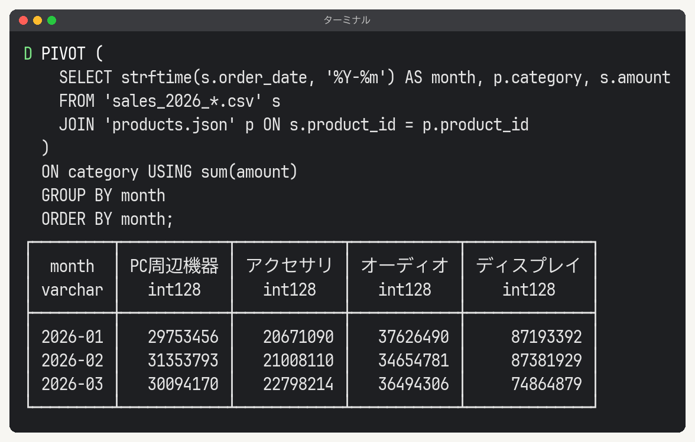

DuckDB の独自の構文を使うと、初めて見る CSV の中身の確認から、月×カテゴリのクロス集計までを短い SQL で書けます。`SUMMARIZE` で全列の型と NULL の割合を1回で見て、`GROUP BY ALL` と `PIVOT` でまとめます。

多くのデータベースの SQL では、`SELECT` に並べた集計でない列を `GROUP BY` にもう一度書く必要があり、列を足すたびに2か所を直すことになります。月×カテゴリのような表も、`PIVOT` の無いデータベースではカテゴリの数だけ `CASE WHEN` を並べることになります。

参考動画は記事の最後に紹介しています。

## 環境

- DuckDB v2.0.0 (Cyanoptera) d54cbbe3df（CLI。Homebrew で導入）
- macOS（Apple シリコン）
- 確認日は 2026-11-14。Linux と Windows では試していません
- サンプルデータの生成に Python 3（標準ライブラリだけ）

## 完成形

```sql
PIVOT (
  SELECT strftime(s.order_date, '%Y-%m') AS month, p.category, s.amount
  FROM 'sales_2026_*.csv' s
  JOIN 'products.json' p ON s.product_id = p.product_id
)
ON category USING sum(amount)
GROUP BY month
ORDER BY month;
```

月ごとの売上の CSV を商品一覧の JSON と JOIN し、月を行・カテゴリを列にして金額を合計します。ファイル名と列名を手元のものに合わせてください。

:::note alert
`GROUP BY ALL` は、`SELECT` にある集計でない列を全部グループ化のキーにします。確認のつもりで列を1つ足すと、その列でも行が分かれます。
:::

## 1. DuckDB を入れて、サンプルのデータを作る

Mac なら Homebrew の1行で入ります。

```bash
brew install duckdb
```

Linux と macOS は、公式のインストールスクリプト `curl https://install.duckdb.org | bash` でも入ります。Windows は公式のインストールのページを見てください。アカウントや設定ファイルは要りません。

データは架空のガジェット店の売上で、サンプルのスクリプトで作ります。乱数の種を固定しているので、件数と合計はこの記事と同じになります。

```bash
git clone https://github.com/zun-tools/duckdb-sample.git
mkdir duckdb-trial && cd duckdb-trial
python3 ../duckdb-sample/gen_sample.py
duckdb
```

月ごとの売上 `sales_2026_01.csv`〜`sales_2026_03.csv`（計 6,000 行）と、商品一覧の `products.json` などができます。この記事で使う列は次のとおりです。

- 売上の CSV（9列）: 注文番号 `order_id`・注文日 `order_date`・商品 ID `product_id`・顧客区分 `customer_type`・数量 `quantity`・金額 `amount`・備考 `note` など
- 商品一覧の JSON: 商品 ID `product_id`・商品名 `name`・カテゴリ `category` など

最後の `duckdb` で対話シェルが起動し、プロンプトが `D` に変わります。以降の SQL はこの中で打ちます。

## 2. `FROM` から書く・`DESCRIBE` で型を見る

DuckDB には、手で探るときに書く量を減らす独自の構文があり、公式は「Friendly SQL」と呼んでいます。最初は `FROM` から書く形と `DESCRIBE` です。

```sql
FROM 'sales_2026_01.csv' LIMIT 3;
DESCRIBE FROM 'sales_2026_01.csv';
```

1行目は `SELECT *` を省いた形です。`DESCRIBE` は列名と型だけを返します。区切り文字と列の型は DuckDB が中身から推論するので、ファイル名を `FROM` に書くだけで済み、`CREATE TABLE` も取り込みも要りません。

## 3. `SUMMARIZE` で全列を一度に見る

初めて見る CSV には、まず `SUMMARIZE` を当てます。

```sql
SUMMARIZE 'sales_2026_01.csv';
```

全列の型・最小・最大・おおよその種類数・平均・分位点・件数・`NULL` の割合が1回で返ります。出力は12列あるので、一部だけ抜き出しました。

| column_name | column_type | min | max | null_percentage |
|---|---|---|---|--:|
| order_date | DATE | 2026-01-01 | 2026-01-31 | 0.00 |
| quantity | BIGINT | 1 | 5 | 0.00 |
| amount | BIGINT | 9458 | 390990 | 0.00 |
| note | VARCHAR | ギフト包装 | 通常発送 | 16.35 |

見る所は `column_type` と `null_percentage` です。数値のはずの列が `VARCHAR` に推論されていれば、集計の前にここで気づけます。`note` のように NULL を含む列も、どれだけ欠けているかが先に分かります。

## 4. `GROUP BY ALL` でグループ化のキーを書かない

```sql
SELECT customer_type, product_id, count(*) AS count, sum(amount) AS total_amount
FROM 'sales_2026_01.csv'
GROUP BY ALL
ORDER BY total_amount DESC
LIMIT 5;
```

| customer_type<br>varchar | product_id<br>varchar | count<br>int64 | total_amount<br>int128 |
|---|---|--:|--:|
| プレミアム | P003 | 103 | 22769168 |
| ゲスト | P003 | 107 | 22528947 |
| 法人 | P003 | 102 | 21935642 |
| 一般会員 | P003 | 91 | 19959635 |
| ゲスト | P004 | 118 | 10597135 |

`GROUP BY ALL` は、`SELECT` に並んだ集計でない列（ここでは `customer_type` と `product_id`）をグループ化のキーとして推論します。`SELECT` の列を足し引きしても、`GROUP BY` は書き直さずに済みます。

## 5. `PIVOT` で月×カテゴリの表にする

月とカテゴリの組み合わせを縦に並べると12行になり、見比べにくくなります。`PIVOT` でカテゴリを列に展開しましょう。カテゴリは `products.json` にあるので、売上の CSV 3本と商品 ID で JOIN してから展開しています。

```sql
PIVOT (
  SELECT strftime(s.order_date, '%Y-%m') AS month, p.category, s.amount
  FROM 'sales_2026_*.csv' s
  JOIN 'products.json' p ON s.product_id = p.product_id
)
ON category USING sum(amount)
GROUP BY month
ORDER BY month;
```


*右端のディスプレイの列だけ、3月が2月より約1,250万円少ない。ほかの3列は大きく動いていない*

`ON` に列へ展開する列、`USING` に各セルの集計、`GROUP BY` に行のキーを書きます。`FROM 'sales_2026_*.csv'` の `*` は glob で、一致するファイルを全部まとめて1つのテーブルとして読みます。

## DuckDB について

DuckDB はサーバーを持たず、`duckdb` と打ったそのプロセスの中で動く分析用のデータベースです。`FROM` の後ろに CSV・JSON・Parquet のファイル名を書けば、表の定義も取り込みの手順も無しに読めます。

## まとめ

| 症状 | 対処 |
|---|---|
| 初めての CSV で、数値列が数値として読まれているか・欠けがどれだけあるか分からない | `SUMMARIZE 'ファイル名.csv'` の `column_type` と `null_percentage` |
| `SELECT` の列を変えるたびに `GROUP BY` も直している | `GROUP BY ALL` |
| 月×カテゴリの集計が縦に長く、見比べにくい | `PIVOT ( ... ) ON category USING sum(amount) GROUP BY month` |

## 参考リンク

- [Friendly SQL](https://duckdb.org/docs/2.0/sql/dialect/friendly_sql.html)
- [SUMMARIZE](https://duckdb.org/docs/2.0/guides/meta/summarize.html)
- [PIVOT](https://duckdb.org/docs/2.0/sql/statements/pivot.html)
- [サンプル: zun-tools/duckdb-sample（gen_sample.py・queries.sql）](https://github.com/zun-tools/duckdb-sample)

## 参考動画

<iframe width="560" height="315" src="https://www.youtube.com/embed/iSwRUF_RQkU" title="YouTube video player" frameborder="0" allowfullscreen></iframe>

---

シリーズの他の記事: https://qiita.com/zundamon-tools/items/3dba4f8a2dfca9ddee79
