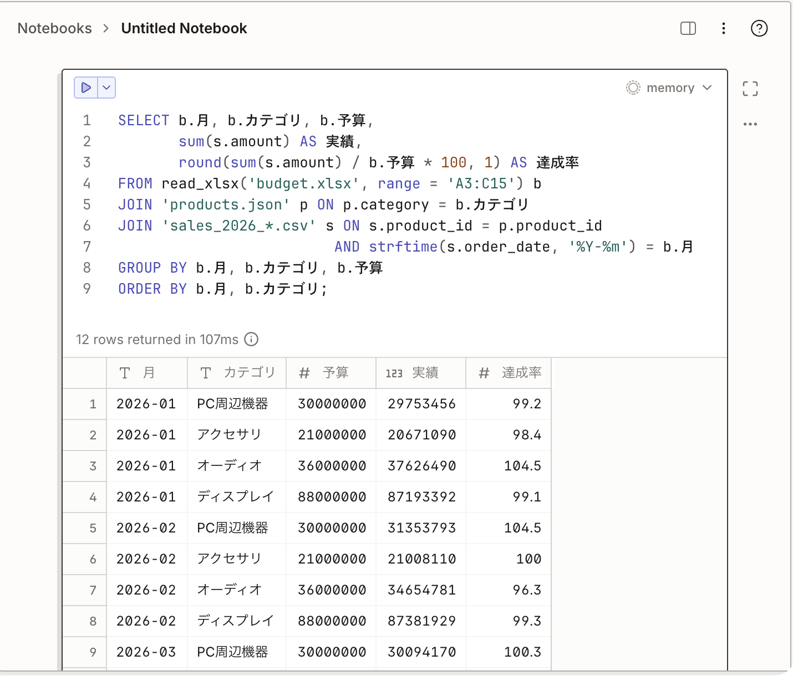
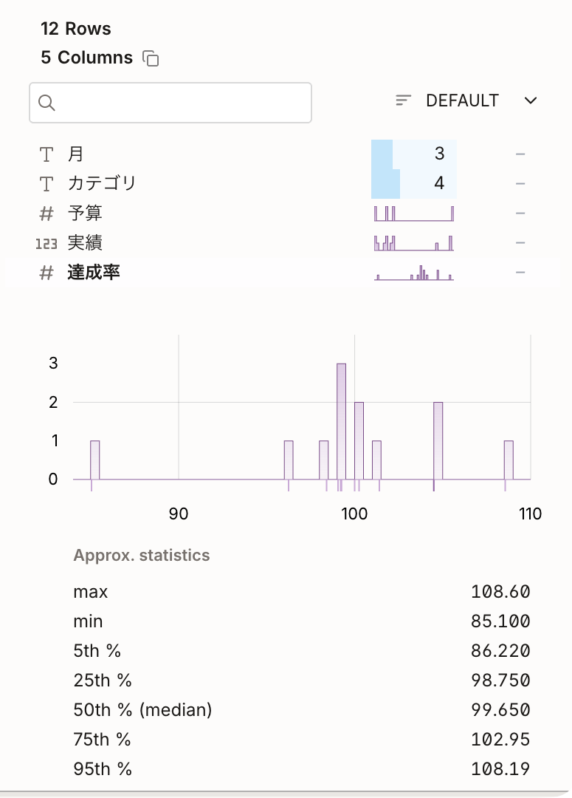

`duckdb -ui` と打つと、DuckDB のノートブックの画面がブラウザに開きます。セルに CLI と同じ SQL を書いて実行し、結果の表と、列ごとのヒストグラム・統計の要約を同じ画面で見られます。

CLI の対話シェルは、10行ほどの SQL を直して打ち直したり、罫線の表を見て回ったりするのに向きません。DuckDB の公式ブログも、CLI は長い SQL を書くのに向かず、データを見て回る道具が限られる点を、この画面を作った理由に挙げています。

参考動画は記事の最後に紹介しています。

## 環境

- DuckDB v2.0.0 (Cyanoptera) d54cbbe3df（Homebrew で導入）
- macOS 26.5.2（Apple シリコン）・Google Chrome
- 確認日は 2026-11-22。Linux と Windows では画面を開いていません
- v2.0.1 用の ui 拡張（osx_arm64・linux_amd64）が配布元に置かれていることは 2026-11-26 に確かめました。v2.0.1 で画面を開くところまでは試していません
- 公式ドキュメントでは、Intel の Mac（osx_amd64）と Windows の Arm 版（windows_arm64）は対象外です

## 完成形

```bash
cd duckdb-trial   # SQL で読みたいファイルがあるフォルダ
duckdb -ui
```

既定のブラウザで `http://localhost:4213/` が開きます。`duckdb -ui` を打ったフォルダにあるファイルは、セルの `FROM` にファイル名だけを書けば読めました。

:::note alert
画面の部品は、DuckDB の中のサーバーが `https://ui.duckdb.org` から取ってきます。データは手元で処理されますが、画面を開くのにネットワーク接続が要ります。
結果の列見出しを押しても、行は並べ替わりませんでした。並べたい順は SQL の `ORDER BY` で書きます。
xlsx を読む前にセルで `COPY ... (FORMAT xlsx)` から始めるときは、先に `LOAD excel;` を書きます。書き出しだけでは excel 拡張が自動で読み込まれず、CLI では `Copy Function with name xlsx does not exist!` で止まりました。
:::

## 1. データを用意して、画面を開く

ここでは、架空のガジェット店の売上 CSV・商品一覧の JSON・予算の xlsx を、ブラウザの画面から SQL で突き合わせます。DuckDB の入れ方は、Mac なら `brew install duckdb` です。

```bash
git clone https://github.com/zun-tools/duckdb-sample.git
mkdir duckdb-trial && cd duckdb-trial
python3 ../duckdb-sample/gen_sample.py
cp ../duckdb-sample/budget.xlsx .
duckdb -ui
```

`gen_sample.py` は、月ごとの売上 `sales_2026_01.csv`〜`sales_2026_03.csv`（計 6,000 行）と商品一覧の `products.json` を作ります。`budget.xlsx` は架空の予算で、1行目に表題、2行目に空行、3行目に見出し「月・カテゴリ・予算」があります。

```text
┌──────────────────────────────────────┐
│                result                │
│               varchar                │
├──────────────────────────────────────┤
│ UI started at http://localhost:4213/ │
└──────────────────────────────────────┘
DuckDB v2.0.0 (Cyanoptera)
Enter ".help" for usage hints.
```

初回は ui 拡張のダウンロードが走りますが、端末には取得中の表示が何も出ず、数秒で上の枠が出ました。端末はそのまま対話シェルとして使えます。

ブラウザには「Welcome to the DuckDB UI」の画面が開きます。「OR GIVE ME AN EMPTY NOTEBOOK」を押すと、空のセルが1つあるノートブックになります。

## 2. セルに SQL を書いて実行する

セルには、CLI で打つのと同じ SQL をそのまま書けます。次の SQL は、予算の xlsx を `range = 'A3:C15'` で見出しの3行目から読み、売上の CSV・商品の JSON とつないで月×カテゴリの達成率を出します。

```sql
SELECT b.月, b.カテゴリ, b.予算,
       sum(s.amount) AS 実績,
       round(sum(s.amount) / b.予算 * 100, 1) AS 達成率
FROM read_xlsx('budget.xlsx', range = 'A3:C15') b
JOIN 'products.json' p ON p.category = b.カテゴリ
JOIN 'sales_2026_*.csv' s ON s.product_id = p.product_id
                         AND strftime(s.order_date, '%Y-%m') = b.月
GROUP BY b.月, b.カテゴリ, b.予算
ORDER BY b.月, b.カテゴリ;
```

セルの左上の ▶（Run）で実行すると、「12 rows returned in 107ms」と出て、下に結果の表が並びます。


*セルに書いた SQL と結果。見出しの記号は列の型（T は文字列、# は小数、123 は整数）*

セルに `LOAD excel;` は書いていませんが、`read_xlsx` は excel 拡張が自動で読み込まれて通りました。公式ドキュメントでも、excel 拡張は初めて使うときに公式の置き場から自動で読み込まれると説明されています。自動に頼らずに入れておくなら、画面を開く前に端末で `duckdb -c "INSTALL excel;"` を一度打ちます。`INSTALL` した拡張は手元に残ります。

## 3. 右の欄で、列ごとの分布と統計を見る

実行すると、画面の右に列の要約の欄が開きます。結果が 12 Rows・5 Columns であることと、各列の型の印・小さなヒストグラムが並びます。文字列の列には異なる値の数が出て、このデータでは「月」が 3、「カテゴリ」が 4 でした。

列の名前を押すと、その列の大きなヒストグラムと「Approx. statistics」が出ます。


*達成率の列を選んだところ。左端に1本だけ離れた棒が、85.1 のディスプレイ 2026-03*

達成率は max 108.60、min 85.100、median 99.650、mean 99.725 でした。12行のうち1行だけが 90 を切っていることが、表の行を目で追わなくても棒の位置で分かります。

この欄が開くとセルの幅が狭くなり、長い行の右端が隠れます。上の帯の右にある欄の開閉ボタンで閉じると、SQL の全文が見えます。

## 4. 結果を持ち出す

結果の表の右下に、クリップボードへのコピーとダウンロードのボタンがあります。コピーはタブ区切りで、表計算ソフト（Numbers）の新しい書類に貼ると表になりました。ダウンロードで選べる形式は CSV・TSV・Parquet・JSON の4つで、xlsx はありません。

xlsx で欲しいときは、セルに `COPY` を書きます。

```sql
COPY (
  SELECT b.月, b.カテゴリ, b.予算,
         sum(s.amount) AS 実績,
         round(sum(s.amount) / b.予算 * 100, 1) AS 達成率
  FROM read_xlsx('budget.xlsx', range = 'A3:C15') b
  JOIN 'products.json' p ON p.category = b.カテゴリ
  JOIN 'sales_2026_*.csv' s ON s.product_id = p.product_id
                           AND strftime(s.order_date, '%Y-%m') = b.月
  GROUP BY b.月, b.カテゴリ, b.予算
  ORDER BY b.月, b.カテゴリ
) TO 'yojitsu_ui.xlsx' (FORMAT xlsx, HEADER true);
```

括弧の中は手順2の `SELECT` から末尾の `;` を外したものです。

セルには書き出した行数（Count 12）が出て、`duckdb -ui` を打ったフォルダに `yojitsu_ui.xlsx` ができます。手順2で `read_xlsx` を実行した後なので、excel 拡張は読み込み済みで `LOAD excel;` なしに通りました。

## 5. 止める・開き直す

端末で `.quit` を打って DuckDB を止めると、数秒でブラウザに「Connection to DuckDB Lost」が出ます。画面は DuckDB のプロセスの一部なので、プロセスと一緒に止まります。つなぎ直すには、端末で `duckdb -ui` を打つか、DuckDB のクライアントから `CALL start_ui();` を実行します。

もう一度 `duckdb -ui` で開き直すと、セルに書いた SQL は残っていて、結果は消えていました。ノートブックは `~/.duckdb/extension_data/ui/` の `ui.db` に保存されます。

## 画面はどこで動いているか

`duckdb -ui` は、起動した DuckDB のプロセスの中に小さな HTTP サーバーを立てます。既定のポートは 4213 です。データベースのサーバーを別に立ててデータを取り込むわけではなく、画面がつながる先は、いま端末で動いている DuckDB そのものです。

画面を再読み込みしたときのブラウザの要求を開発者ツールで見ると、すべて `localhost:4213` 宛てでした。公式ドキュメントも、既定の設定について "your queries and data never leave your computer" と説明しています。問い合わせもデータも、手元のコンピューターから出ないという意味です。

## 画面を作っているのは MotherDuck

この画面は、DuckDB を使ったクラウドサービスの会社 MotherDuck が作って保守しています。左の欄の一番下に「Sign in to MotherDuck」のボタンがありますが、サインインは任意で、押さなくてもここまでの操作はすべてできました。ui 拡張のリポジトリは MIT ライセンスで公開されていますが、画面側のコードの大半はまだ公開されていないと README に書かれています。

## まとめ

| 症状 | 対処 |
|---|---|
| 長い SQL を CLI で直して打ち直すのが手間 | `duckdb -ui` を打ち、ノートブックのセルに書いて ▶ で実行 |
| 結果の列の分布や外れ値をすぐ見たい | 右の欄の小さなヒストグラム。列の名前を押すと統計 |
| 見出しを押しても並べ替わらない | SQL の `ORDER BY` で並べる |
| 画面から xlsx でダウンロードできない | セルに `COPY (...) TO 'ファイル名.xlsx' (FORMAT xlsx, HEADER true);` |
| 「Connection to DuckDB Lost」 | 端末で `duckdb -ui` を打ち直す。セルの SQL は残っている |

## 参考リンク

- [ui 拡張（起動・ポート・データの所在・対応機種）](https://duckdb.org/docs/2.0/core_extensions/ui)
- [DuckDB UI の発表（公式ブログ）](https://duckdb.org/2025/03/12/duckdb-ui)
- [サンプル: zun-tools/duckdb-sample（budget.xlsx・セルに書いた SQL の queries_no02.sql）](https://github.com/zun-tools/duckdb-sample)

## 参考動画

<iframe width="560" height="315" src="https://www.youtube.com/embed/j4nxwEnMy2w" title="YouTube video player" frameborder="0" allowfullscreen></iframe>

---

シリーズの他の記事: https://qiita.com/zundamon-tools/items/3dba4f8a2dfca9ddee79
