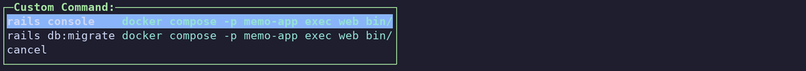
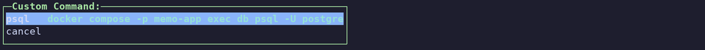

`docker compose exec web bin/rails db:migrate` のような長いコマンドを、lazydocker の設定ファイルの `customCommands` に登録すると、サービスを選んで `c` を押したメニューから走らせられます。`serviceNames` で、コマンドを出すサービスも絞れます。

Rails を compose で動かしていると、マイグレーションやコンソールのたびに `docker compose exec web bin/rails …` を打つことになります。lazydocker の Services のキーで直接開けるのはシェル（`E`）までで、決まったコマンドを走らせるには設定で登録する必要があります。

参考動画は記事の最後に紹介しています。

## 環境

- lazydocker v0.25.2（Linux arm64 の公式バイナリ）
- Docker Engine 29.6.1・Docker Compose v5.2.0（`docker-compose` コマンドは入っていない環境）
- Linux（aarch64）。確認日は 2026-11-12
- macOS・Docker Desktop・OrbStack・Colima では試していません
- サンプルのアプリは Rails 8.1 と Postgres 17 で、どちらもコンテナの中で動きます

## 完成形

lazydocker の設定ファイル `config.yml` に、次の内容を書きます。

```yaml:config.yml
customCommands:
  services:
    - name: rails db:migrate
      attach: true
      command: '{{ .DockerCompose }} exec {{ .Service.Name }} bin/rails db:migrate'
      serviceNames: [web]
    - name: rails console
      attach: true
      command: '{{ .DockerCompose }} exec {{ .Service.Name }} bin/rails console'
      serviceNames: [web]
    - name: psql
      attach: true
      command: '{{ .DockerCompose }} exec {{ .Service.Name }} psql -U postgres'
      serviceNames: [db]
```

設定ファイルの場所:

| OS | 場所 |
|---|---|
| macOS | `~/Library/Application Support/jesseduffield/lazydocker/config.yml` |
| Linux | `~/.config/lazydocker/config.yml` |
| Windows | `%AppData%\lazydocker\config.yml` |

サンプルの `lazydocker/config.yml` は上の YAML と同じ中身なので、そのまま設定ファイルへ写せます。手元のプロジェクトに合わせて書き換えるのは、`serviceNames` のサービス名と `exec` の後ろのコマンドの2か所です。

:::note alert
設定を保存しても、lazydocker を開き直すまで `c` のメニューには出ません。コマンドごとにキーを割り当てる欄も無く、呼び出しは `c` のメニューからだけです。
:::

## 1. サンプルを立てる

lazydocker は、Mac なら公式の README にある `brew install lazydocker` で入ります。ほかの OS の入れ方は README の Installation の節にまとまっています。要件は、README では Docker 29.0.0 以上です。

サンプルは Rails（web）と Postgres（db）の compose 構成です。`compose.yml` は DB の接続先をわざと間違えた版なので、修正済みの `compose.fixed.yml` で置き換えてから起動します。

```bash
git clone https://github.com/zun-tools/lazydocker-sample.git memo-app
cd memo-app
cp compose.fixed.yml compose.yml
docker compose up -d
```

ディレクトリ名を `memo-app` にすると、compose のプロジェクト名がこの記事の出力と揃います。この時点の `http://localhost:3000/` は `Migrations are pending.` のエラー画面なので、マイグレーションをメニューから流すところまで進めます。

## 2. lazydocker から設定ファイルを開く

同じディレクトリで `lazydocker` を起動し、`1` で Project パネルへ移って `e` を押すと、設定ファイルがエディタで開きます。エディタは `$VISUAL`、次に `$EDITOR` の順で決まり、どちらも無ければ vi です。

初回の設定ファイルは空でした。完成形の `customCommands` を書いて保存し、エディタを閉じると次の行が出ます。`enter` で lazydocker に戻ります。

```text
Press enter to return to lazydocker (this prompt can be disabled in your config by setting `gui.returnImmediately: true`)
```

この確認は `gui.returnImmediately: true` で省けます。

## 3. 各項目の意味

| 項目 | 意味 |
|---|---|
| `name` | メニューに出る名前 |
| `attach` | `true` なら lazydocker の画面からコマンドの画面へ切り替えて走らせる（対話できる）。`false` なら裏で走らせる |
| `command` | 走らせるコマンド。Go のテンプレートで書ける |
| `serviceNames` | このコマンドを出すサービス |

`{{ .DockerCompose }}` の既定は `docker compose` で、この環境では `docker compose -p memo-app` とプロジェクト名付きで展開されました。`{{ .Service.Name }}` には選択中のサービス名が入ります。`customCommands` の下の `services` は、Services パネル用のコマンドを並べる場所です。

## 4. 開き直して、`c` で rails db:migrate を流す

保存直後に web で `c` を押しても、メニューは `cancel` だけでした。`q` で終了し、`lazydocker` を起動し直してから `2` で Services へ移り、web で `c` を押すと、web 用の2つだけが出ます。



並びは config.yml に書いた順の逆で、`rails console` が上でした。`rails db:migrate` を選んで `enter` を押すと、画面がコマンドの出力に切り替わります。

```text
+ docker compose -p memo-app exec web bin/rails db:migrate

== 20261112114337 CreateMemos: migrating ======================================
-- create_table(:memos)
   -> 0.0030s
== 20261112114337 CreateMemos: migrated (0.0030s) =============================

Press enter to return to lazydocker (this prompt can be disabled in your config by setting `gui.returnImmediately: true`)
```

`+` の行が、テンプレートを展開した後に実際に走ったコマンドです。`enter` で戻ってブラウザを再読み込みすると、メモの一覧が表示されました。公式の設定の説明文には `docker-compose` と書いた行もありますが、既定値は `docker compose` です。`docker-compose` コマンドが無いこの環境でも、設定を変えずに通りました。

## 5. 対話するコマンドも同じメニューから開く

`attach: true` なら、REPL のような対話型のコマンドもそのまま使えます。web で `c` → `rails console`:

```text
+ docker compose -p memo-app exec web bin/rails console

Loading development environment (Rails 8.1.4.1)
memo-app(dev):001> Memo.count
  Memo Count (17.7ms)  SELECT COUNT(*) FROM "memos" /*application='MemoApp'*/
=> 0
memo-app(dev):002> exit
```

`exit` の後も同じ確認の行が出て、`enter` で lazydocker に戻ります。db で `c` を押すと、db 用の `psql` だけが出ます。



`psql -U postgres` の接続先は `postgres` データベースです。アプリのテーブルは、`\c memo_development` で切り替えてから `\dt` で見ます。

```text
postgres=# \c memo_development
You are now connected to database "memo_development" as user "postgres".
memo_development=# \dt
                List of relations
 Schema |         Name         | Type  |  Owner
--------+----------------------+-------+----------
 public | ar_internal_metadata | table | postgres
 public | memos                | table | postgres
 public | schema_migrations    | table | postgres
(3 rows)
```

`\q` と `enter` で lazydocker に戻ります。compose.yml のパスワード `postgres` は、このサンプル専用の値です。

## 6. メニューに出ないときに確かめる2点

- `serviceNames` に書いた名前が、compose.yml のサービス名と同じか
- 設定を保存した後に、lazydocker を開き直したか

## lazydocker について

Docker と docker compose をターミナルの1画面で扱う TUI です。作者は lazygit と同じ Jesse Duffield で、Go 製・MIT ライセンスの OSS です。README は、必要な情報を1つの窓に集め、よく使うコマンドをキー1つで呼べて、独自のコマンドも足せる道具だと説明しています。

## まとめ

| 症状 | 対処 |
|---|---|
| `docker compose exec web bin/rails db:migrate` を毎回打っている | `customCommands` の `services` に登録し、サービスを選んで `c` から呼ぶ |
| 保存したのに `c` のメニューが `cancel` だけ | `q` で終了して lazydocker を開き直す |
| 開き直してもコマンドが出ない | `serviceNames` が compose.yml のサービス名と一致しているか確かめる |
| コマンドの後に毎回 `Press enter to return to lazydocker` が出る | `gui.returnImmediately: true` |
| `psql -U postgres` の接続先が `postgres` データベースになる | `\c memo_development` で切り替えてから `\dt` |

## 参考リンク

- [lazydocker の設定（customCommands・設定ファイルの場所）](https://github.com/jesseduffield/lazydocker/blob/v0.25.2/docs/Config.md)
- [lazydocker のキー一覧（v0.25.2）](https://github.com/jesseduffield/lazydocker/blob/v0.25.2/docs/keybindings/Keybindings_en.md)
- [docker compose exec](https://docs.docker.com/reference/cli/docker/compose/exec/)
- [サンプル: zun-tools/lazydocker-sample（lazydocker/config.yml）](https://github.com/zun-tools/lazydocker-sample)

## 参考動画

<iframe width="560" height="315" src="https://www.youtube.com/embed/fJPAYU2DhpE" title="YouTube video player" frameborder="0" allowfullscreen></iframe>

---

シリーズの他の記事: https://qiita.com/zundamon-tools/private/975c61779740d6113fd7
