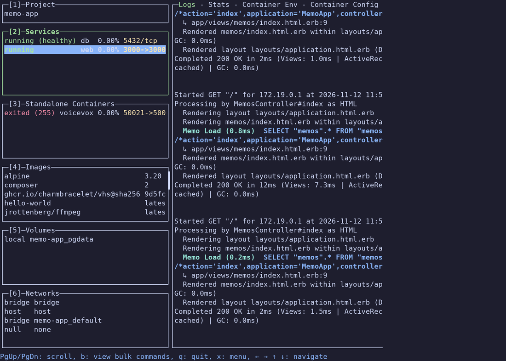

lazydocker で docker compose の開発環境を扱う方法を、課題ごとに2本の記事にしました。この記事は入口として、インストールと画面構成、困ったときのキーの早見表を載せています。

参考動画は記事の最後に紹介しています。

## 記事の一覧

- 「落ちたコンテナを直す」https://qiita.com/zundamon-tools/private/3834b64259d4b101cd22
  落ちたサービスとログを1画面で見つけ、compose.yml を直したら `r` ではなく `R` → recreate で作り直す
- 「長いコマンドを登録する」https://qiita.com/zundamon-tools/private/e92d6b5d31c884fdd368
  `docker compose exec` で打つ rails db:migrate・rails console・psql を `customCommands` に登録し、`c` のメニューから呼ぶ

どちらも Rails と Postgres のサンプル（[zun-tools/lazydocker-sample](https://github.com/zun-tools/lazydocker-sample)）を使います。手順と出力は、lazydocker v0.25.2・Docker Engine 29.6.1（Linux）で 2026-11-12 に確かめたものです。

## 入れて開く

要件は、lazydocker の README では Docker 29.0.0 以上です。インストール方法は README の Installation の節にあり、Mac は Homebrew の1行です。

```bash
brew install lazydocker
```

Linux と Windows 向けには、バイナリ・Scoop・Chocolatey・`go install` などがあります。この記事の手順を確かめたのは Linux で、macOS・Docker Desktop・OrbStack・Colima では試していません。

compose ファイルのあるディレクトリで `lazydocker` を起動します。終了は `q` で、`esc` では終わりません。

## 画面の見方



左の6つのパネルは数字キーで移動します。

| キー | 一覧 | 中身 |
|---|---|---|
| `1` | Project | compose のプロジェクト |
| `2` | Services | compose のサービス（web・db など） |
| `3` | Standalone Containers | compose の外で起動したコンテナ |
| `4` | Images | イメージ |
| `5` | Volumes | ボリューム |
| `6` | Networks | ネットワーク |

compose のサービスは Standalone Containers には出ないので、`2` の Services で探します。右側のタブは `[` `]` で切り替え、Services では Logs・Stats・Container Env・Container Config・Top の5つです。

## 困ったときのキー

キーを覚えていなくても、`x`（または `?`）でそのパネルで使えるキーの一覧が開きます。

| 目的 | キー | 動作・注意 |
|---|---|---|
| 確認 | `enter` → `+` | 右のログにフォーカスしてから `+`。1回目でログが全幅、2回目で Services とログが半々、3回目で元の幅に戻る |
| 確認 | `]` | Stats タブで CPU・メモリのグラフ、Container Env タブで環境変数 |
| 確認 | `1` → `]` | Project の Docker-Compose Config タブ。`docker compose config` の出力で、build のパスが絶対パスになるなど既定値を補った後の設定 |
| 確認 | `/` | 名前の一部で一覧を絞り込む |
| 修正 | `r` | restart。compose.yml の変更は反映されない |
| 修正 | `R` | recreate（compose.yml を直したとき）・rebuild（イメージの中身を変えたとき） |
| 修正 | `c` | `customCommands` に登録したコマンドを選んで実行 |
| 修正 | `E` | コンテナ内のシェル。bash の無いイメージでは `/bin/sh` |
| 修正 | `w` | 最初のポートの URL をブラウザで開く |
| 修正 | `D` | プロジェクト全体を down（`docker compose down`）。down project with volumes はボリュームも削除 |
| 修正 | `U` | プロジェクト全体を up（`docker compose up -d`）。確認ダイアログの後に実行 |
| 掃除 | `b` | 一括操作のメニュー。Standalone Containers に prune exited containers、Images に prune unused images、Volumes に prune unused volumes |

`U` は `D` で落とした後にプロジェクトを上げ直すためのキーです。compose.yml を直したサービスには、選んだサービスを作り直す `R` → recreate を使います。

`D` では通常の down project を選びます。Docker の公式ドキュメントによると、down がボリュームを消すのは `--volumes` を付けたときだけです。prune は未使用のリソースをまとめて消す操作で、元に戻せません。実行前の確認ダイアログで対象を確かめてください。

## lazydocker とは

Docker と docker compose をターミナルの1画面で扱う TUI です。コンテナの状態・ログ・CPU とメモリを並べて見られ、再起動や作り直しはキー1つ。裏で走るのは通常の `docker` と `docker compose` なので、シェルからの操作と混ぜて使えます。

作者は lazygit と同じ Jesse Duffield で、Go 製・MIT ライセンスの OSS です。最新のリリースは v0.25.2（2026-04-19）です。

## 参考リンク

- [lazydocker（公式リポジトリ・入れ方の一覧）](https://github.com/jesseduffield/lazydocker)
- [lazydocker のキー一覧（v0.25.2）](https://github.com/jesseduffield/lazydocker/blob/v0.25.2/docs/keybindings/Keybindings_en.md)
- [lazydocker の設定（v0.25.2）](https://github.com/jesseduffield/lazydocker/blob/v0.25.2/docs/Config.md)
- [サンプル: zun-tools/lazydocker-sample](https://github.com/zun-tools/lazydocker-sample)

## 参考動画

<iframe width="560" height="315" src="https://www.youtube.com/embed/fJPAYU2DhpE" title="YouTube video player" frameborder="0" allowfullscreen></iframe>
