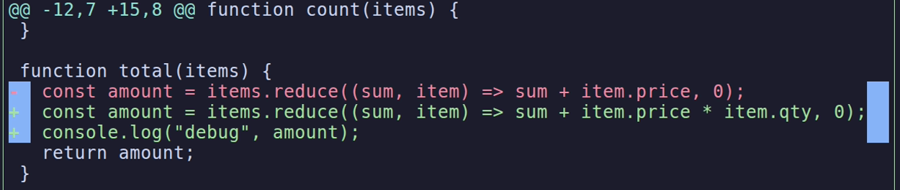
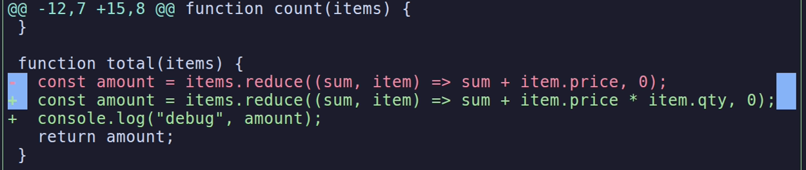
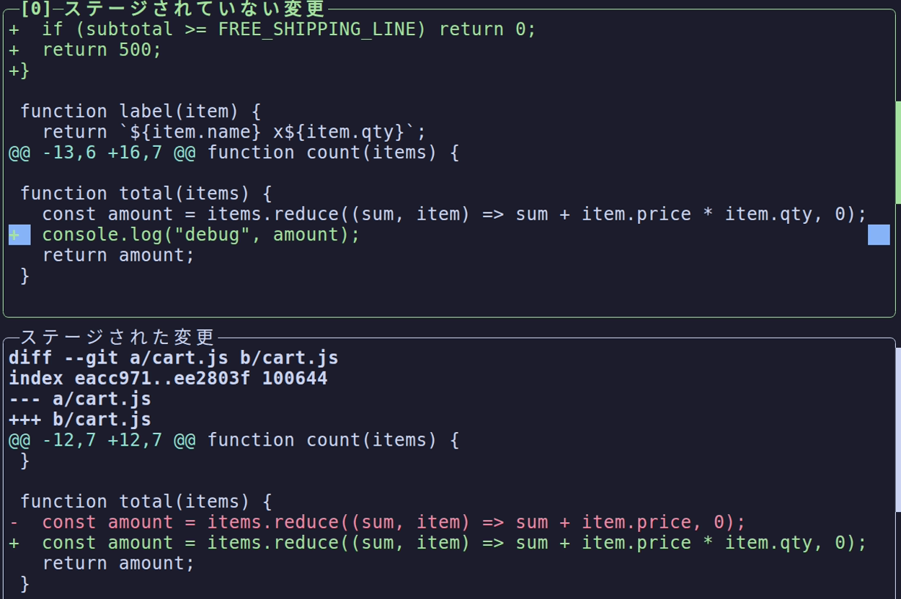

1つのファイルにバグの修正・整形・確認用の `console.log` が混ざっていても、lazygit なら修正と整形を別々のコミットに分けられます。差分の画面で、要る行だけを選んで stage します。使うキーは `enter` → `a` → `v` → `space` → `c` です。

バグを直しながら整形やデバッグ出力も足すと、1つのファイルに意味の違う変更が混ざります。ファイル単位で stage すると、それが全部1つのコミットに入ります。

参考動画は記事の最後に紹介しています。

## 環境

- lazygit 0.66.3（Linux arm64 の公式リリースのバイナリ）
- git 2.53.0・Node.js v22.22.1（サンプルのスクリプトが `node` を使う）
- 確認日は 2026-11-12。macOS では試していません。Homebrew の formula は同日の時点で v0.66.3 でした
- 画像は日本語表示（設定 `gui.language: ja`）で撮ったものです

## 完成形

リポジトリの中で `lazygit` を起動し、ファイルの一覧で対象のファイルを選んでから打ちます。

1. `enter` で差分の画面へ。`→` で目当てのまとまり（画面の表示では「ハンク」）へ移る
2. `a` で行の選択に切り替え、`v` → `↓` で要る行だけを範囲選択
3. `space` で stage し、`c` でメッセージを入れてコミット
4. `esc` → `2` → `enter` で差分の画面に入り直し、`←` で整形のまとまりへ戻ってから `space` → `c`（入り直した直後の選択は、前に選んでいたまとまりに残っている）
5. 要らない行は差分の画面で `d`。確認が出るので、捨てるなら `enter`、やめるなら `esc`

:::note alert
差分の画面に入った直後の選択は、行ではなくまとまりです。修正の直下に足した `console.log` は修正と同じまとまりに入るので、そのまま `space` を押すと一緒に stage されます。`a` で行の選択に切り替えてから選びます。
:::

## 1. lazygit を入れて、混ざった変更を作る

Mac なら公式の README にある Homebrew の1行で入ります。Homebrew の formula には Linux（arm64・x86_64）向けの bottle もあります。

```bash
brew install lazygit
```

確認に使った Linux では、[GitHub Releases](https://github.com/jesseduffield/lazygit/releases) から CPU（`uname -m`）に合う Linux 用の asset と `checksums.txt` を落としました。sha256 を照合してから、`lazygit` のバイナリだけを展開しています。Windows 向けの Scoop などの入れ方は、README の Installation の節にあります。

練習にはサンプルのリポジトリを使います。`total()` に数量を掛け忘れたバグが入った `cart.js` があり、スクリプトで「混ざった変更」を作れます。

```bash
git clone https://github.com/zun-tools/lazygit-sample.git
cd lazygit-sample
./scripts/make-mixed-change.sh
```

```text
混ざった変更を作りました。git diff で確かめてください。
```

`git diff` には2つの `@@` が出ます。1つ目は `shipping()` の1行を4行にした整形、2つ目は `total()` の修正と `console.log` です。

```diff
@@ -1,7 +1,10 @@
 // カートの計算
 const FREE_SHIPPING_LINE = 3000;
 
-function shipping(subtotal) { if (subtotal >= FREE_SHIPPING_LINE) return 0; return 500 }
+function shipping(subtotal) {
+  if (subtotal >= FREE_SHIPPING_LINE) return 0;
+  return 500;
+}
 
 function label(item) {
   return `${item.name} x${item.qty}`;
@@ -12,7 +15,8 @@ function count(items) {
 }
 
 function total(items) {
-  const amount = items.reduce((sum, item) => sum + item.price, 0);
+  const amount = items.reduce((sum, item) => sum + item.price * item.qty, 0);
+  console.log("debug", amount);
   return amount;
 }
```

ゴールは、`const amount` の `-`／`+` の2行を `fix` のコミットに、`shipping()` の整形を `style` のコミットに入れ、`console.log` は捨てることです。

## 2. 差分の画面で、修正の2行だけを選ぶ

`lazygit` を起動すると、ファイルの一覧で `cart.js` が選ばれた状態になります。`enter` で右の差分の画面に入ると、1つ目のまとまり（`shipping()` の整形）が選ばれます。

`→` を押すと、2つ目のまとまりへ移ります。



`-const`・`+const`・`+console.log` の3行がまとめて選ばれました。冒頭の注意のとおり、このまま `space` は押しません。

`a` を押すと行の選択に切り替わり、先頭の `-` の1行だけが選ばれます。画面下のキーの案内も「1行ずつ選択: a」から「ハンクを選択: a」に変わるので、いまどちらの選択かが分かります。続けて `v` で範囲選択を始め、`↓` で1行広げます。



`console.log` は範囲の外に残りました。

## 3. stage して、修正のコミットを作る

`space` で選んだ2行を stage します。差分の画面が上下に分かれ、下の欄「ステージされた変更」に2行が移ります。



上の欄は、まだ stage していない整形のまとまり（画面に収まった下側だけ）と `console.log` です。選択の印は `console.log` の行に残っています。この位置は、次の節の落とし穴につながります。

README によると、stage しすぎたときは `tab` で下の欄へ移り、その行で `space` を押せば stage から外れます。

差分の画面のまま `c` を押すとメッセージの入力欄が出ます。`fix: 合計の計算を直す` と打って `enter` で確定します。

## 4. 整形のまとまりを、別のコミットにする

`esc` で差分の画面を抜け、`2` でファイルの一覧へ移り、`enter` でもう一度差分の画面に入ります。左のパネルには `[1]`〜`[5]` の番号があり、数字キーでそのパネルへ移れます（`2` はファイル、`4` はコミット）。

:::note alert
コミットの直後に差分の画面へ入り直すと、選択は2つ目のまとまり（残った `console.log`）にあります。そのまま `space` を押すと、`console.log` が整形のコミットに入ります。
:::

`←` で1つ目の整形のまとまりへ戻り、`space` でまとまりごと stage します。このまとまりは整形の `-` 1行と `+` 4行だけで、ほかの変更が混ざっていないので、行の選択に切り替える必要はありません。`c` → `style: 整形` → `enter` でコミットします。

## 5. 確認用の `console.log` を `d` で捨てる

もう一度 `esc` → `2` → `enter` で差分の画面に入ると、残りは `console.log` の1行だけです。`d` を押すと確認が出ます。下のキーの案内は「確認: <enter> | 閉じる/キャンセル: <esc>」です。

```text
この変更を破棄しますか（git reset）？これは元に戻せません。
このダイアログを無効にするには、'gui.skipDiscardChangeWarning'の設定キーをtrueに設定してください
```

`enter` で確定すると、ファイルの一覧は空になります。

:::note alert
捨てた行は lazygit の取り消し `z` でも戻りません。Undoing.md には "we can't undo changes to the working tree or stash" とあります。
捨てた直後の `z` は、直前のコミット（`style: 整形`）を外すソフトリセットの確認を出します。止めるなら `esc` です。
:::

## 6. コミットが2つに分かれたことを確かめる

`4` でコミットのパネルへ移ると、先頭に `style: 整形`、その下に `fix: 合計の計算を直す` が並びます。シェルの `git` で見ても同じです（ハッシュは環境ごとに変わります）。

```bash
git log --oneline -2
```

```text
c317429 (HEAD -> main) style: 整形
acde943 fix: 合計の計算を直す
```

`fix` のコミットの中身も見ます。

```bash
git show HEAD~1
```

出力のうち差分の部分です。入ったのは `const amount` の2行だけでした。

```diff
@@ -12,7 +12,7 @@ function count(items) {
 }
 
 function total(items) {
-  const amount = items.reduce((sum, item) => sum + item.price, 0);
+  const amount = items.reduce((sum, item) => sum + item.price * item.qty, 0);
   return amount;
 }
```

`style: 整形` のコミットには `shipping()` の整形だけが入り、`console.log` はどちらのコミットにも、作業ツリーにも残っていません。

## lazygit の「まとまり」は git の `@@` とは別物

差分の画面で最初に選ばれる単位を、lazygit の画面は「ハンク」と呼びます。v0.66.3 のソース（`pkg/gui/controllers/helpers/diff_line_queries.go`）では、変わっていない行で区切られた、続けて変わった行のまとまりとして定義されています。追加と削除が混ざってよく、git の `@@` 1つの中に複数のまとまりが入ることもあります。

今回の2つ目の `@@` では `-const`・`+const`・`+console.log` の間に変わっていない行が無いため、3行で1つのまとまりでした。`console.log` と修正の間に変わっていない行が1行でもあれば別のまとまりになり、`→` と `space` だけで分けられます。差分の画面がまとまり単位で始まるのは、設定 `useHunkModeInDiffView` の既定が true だからです。

`git add -p` は、git の塊ごとに stage するかを順に答えていく形です。lazygit では差分全体を見ながら要る行へ直接移り、行単位で選べます。

v0.66.0 のリリースノートには "Staging hunks is now done directly from the main view." とあります。ハンクの stage はメインの差分の画面で直接するようになり、独立したステージングの画面は無くなりました。それより前の版を前提にした記事とはキーの流れが違うので、迷ったら `?` で今いる画面のキー一覧を出します。

## 差分の画面で使うキー

| キー | 動き |
|---|---|
| `enter` | ファイルの一覧から差分の画面へ入る |
| `→`／`←` | 次／前のまとまりへ移る |
| `a` | まとまりの選択と行の選択を切り替える |
| `v` → `↑`／`↓` | 範囲選択 |
| `space` | 選んだ所を stage する（下の欄では stage から外す） |
| `tab` | 上下の欄を行き来する |
| `c` | コミット |
| `d` | 選んだ所を捨てる（確認あり・`z` では戻らない） |
| `esc` | 差分の画面を抜ける |
| `?` | 今いる画面のキー一覧 |

## まとめ

| 症状 | 対処 |
|---|---|
| ファイルごとの `space` で、混ざった変更が全部1つのコミットに入る | `enter` で差分の画面に入り、まとまりか行を選んで `space` |
| まとまりで選ぶと、修正と `console.log` が一緒に選ばれる | `a` で行の選択に切り替え、`v` → `↓` で要る行だけ |
| 1つ目をコミットした後、整形のつもりの `space` で `console.log` が入る | 入り直した直後の選択は2つ目のまとまり。`←` で整形へ戻ってから `space` |
| stage しすぎた | `tab` で下の欄へ移り、その行で `space` |
| `d` で捨てた行を `z` で戻そうとすると、コミットを外す確認が出る | `d` で捨てた行は戻らない。`z` の確認は `esc` で閉じる。`d` の確認も、迷ったら `esc` |
| 古い記事の手順とキーが違う | v0.66.0 で、ハンクや行の stage は差分の画面で直接する形になった。`?` でキーを確かめる |

## 参考リンク

- [lazygit（公式リポジトリ・README の「Stage hunks or individual lines」）](https://github.com/jesseduffield/lazygit)
- [v0.66.0 のリリースノート](https://github.com/jesseduffield/lazygit/releases/tag/v0.66.0)
- [lazygit のキー一覧（v0.66.3）](https://github.com/jesseduffield/lazygit/blob/v0.66.3/docs/keybindings/Keybindings_en.md)
- [Undoing.md（`z` で戻せる物・戻せない物）](https://github.com/jesseduffield/lazygit/blob/v0.66.3/docs/Undoing.md)
- [サンプル: zun-tools/lazygit-sample（make-mixed-change.sh）](https://github.com/zun-tools/lazygit-sample)

## 参考動画

<iframe width="560" height="315" src="https://www.youtube.com/embed/5xrwhkmcCVQ" title="YouTube video player" frameborder="0" allowfullscreen></iframe>
