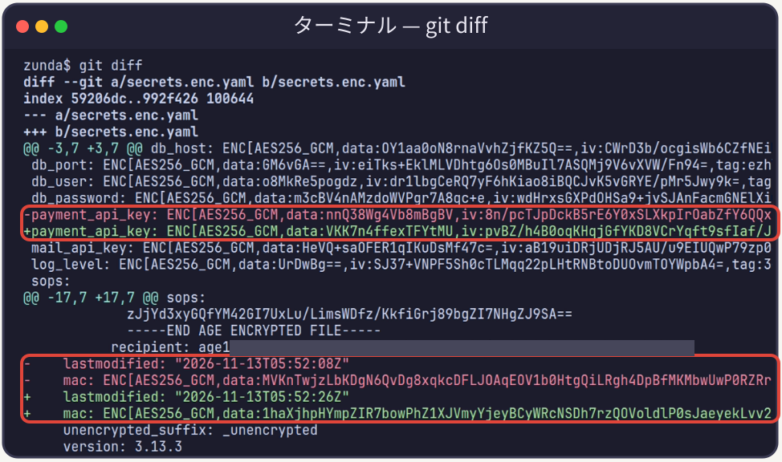

SOPS は YAML の値だけを暗号化します。暗号化したまま Git に置いても、`git diff` に出るのは変えた項目の行と、末尾の `sops:` 欄の `lastmodified`・`mac` だけです。鍵を持つ人は textconv で平文の差分も読めます。チームの鍵は `.sops.yaml` に公開鍵を足し、`sops updatekeys` で共有します。

設定ファイルを age で丸ごと暗号化して Git に置くと、API キーを1つ直しただけで、暗号文の行が全部 `-`／`+` で入れ替わります。レビューでは、どの項目を変えたのかが分かりません。なお SOPS でも項目の名前は暗号化されないので、公開リポジトリに置いてよいわけではありません。

参考動画は記事の最後に紹介しています。

## 環境

- sops 3.13.3・age v1.3.2・git 2.53.0
- Linux（arm64）。確認日は 2026-11-13
- macOS（arm64）でも、同じ版で鍵の作成・暗号化・`git diff` を 2026-11-04 に確かめています
- 記事に出る秘密の値はすべてダミー、公開鍵は先頭だけの省略形です

## 完成形

1\. 暗号化したい設定を、平文のまま `secrets.enc.yaml` の名前で置きます（まだコミットしない）。

2\. 自分の鍵をリポジトリの外に作り、場所を SOPS に教えます。

```bash
mkdir -p ~/.config/sops/age && age-keygen -o ~/.config/sops/age/keys.txt
export SOPS_AGE_KEY_FILE=~/.config/sops/age/keys.txt
```

3\. リポジトリの直下に `.sops.yaml` を書きます。`age1...` には、`age-keygen` が出した `Public key:` の値を貼ります。

```yaml:.sops.yaml
creation_rules:
  - path_regex: \.enc\.yaml$
    age: age1...
```

4\. 暗号化してから、2つのファイルだけをコミットします。

```bash
sops encrypt -i secrets.enc.yaml
git add .sops.yaml secrets.enc.yaml && git commit -m "暗号化した設定"
```

5\. 書き換えて、差分を見ます。

```bash
sops edit secrets.enc.yaml
git diff
```

6\. 鍵を持つ人の手元だけ、差分を平文にします（`.gitattributes` には1行を追記）。

```bash
echo '*.enc.yaml diff=sopsdiffer' >> .gitattributes
git config diff.sopsdiffer.textconv "sops decrypt"
```

7\. 相手は自分の端末で 2 と同じ2行を打ち、`Public key:` の値だけを渡します。2行目の `export` は、相手が Mac のときも要ります。受け取った公開鍵を `.sops.yaml` の `age:` にカンマ区切りで足してから、次を打ちます。

```bash
sops updatekeys secrets.enc.yaml   # Is this okay? (y/n): に y
git add .sops.yaml secrets.enc.yaml && git commit -m "recipient を追加"
```

:::note alert
平文のまま一度コミットした秘密は、あとで暗号化しても `git log -p` に残ります。GitHub Docs の手順では、まずその秘密を取り消すか取り替えます。
:::

## 1. SOPS と age を入れる

Mac なら Homebrew の1行です。homebrew-core に sops の formula があり、age の README にも Homebrew での入れ方が載っています。

```bash
brew install sops age
```

確認に使った Linux では、どちらも公式のリリースのバイナリを入れました（[sops のリリース](https://github.com/getsops/sops/releases)・[age のリリース](https://github.com/FiloSottile/age/releases)）。入った版はこう確かめます。

```bash
sops --version
age --version
```

```text
sops 3.13.3 (latest)
v1.3.2
```

どちらも無料の OSS で、鍵も手元で作るので、クラウドのアカウントは要りません。

## 2. 平文の設定ファイルを置く

Git のリポジトリに、平文の設定を `secrets.enc.yaml` の名前で置きます。この名前が、後で書く `.sops.yaml` の `path_regex`（`\.enc\.yaml$`）に合います。

```yaml:secrets.enc.yaml
shop_name: zunda-shop
db_host: db.zunda.example
db_port: 5432
db_user: zunda_app
db_password: dummy_db_pass_0001
payment_api_key: zk_test_0001
mail_api_key: zk_test_mail_0001
log_level: info
```

暗号化する前のこのファイルは、コミットしません。すでに平文でコミットしてある設定なら、上の alert のとおり、暗号化より先に中の秘密を取り替えます。

## 3. age の鍵を作り、場所を SOPS に教える

```bash
mkdir -p ~/.config/sops/age && age-keygen -o ~/.config/sops/age/keys.txt
```

```text
Public key: age1ct96…
```

`keys.txt` には秘密鍵が入ります。リポジトリの外に置くのはこのためです。`mkdir -p` を抜いてディレクトリが無いと、`age-keygen` は `failed to open output file` で止まります。

続けて、鍵の場所を環境変数 `SOPS_AGE_KEY_FILE` で SOPS に教えます。

```bash
export SOPS_AGE_KEY_FILE=~/.config/sops/age/keys.txt
```

公式ドキュメントの age の節によると、SOPS が鍵を探す既定の場所は、Linux が `~/.config/sops/age/keys.txt`、macOS が `~/Library/Application Support/sops/age/keys.txt` です。Mac で上のパスに作ったときは、この `export` が要ります。新しいシェルでは消えるので、シェルの設定ファイルにも書いておきます。

## 4. `.sops.yaml` を書いて暗号化する

`.sops.yaml` は「どのファイルを、どの公開鍵あてに暗号化するか」の決まりです。リポジトリの直下に置きます。

```yaml:.sops.yaml
creation_rules:
  - path_regex: \.enc\.yaml$
    age: age1ct96…
```

`path_regex` に合うファイルを、`age:` に並べた公開鍵あてに暗号化します。この公開鍵を、SOPS は recipient と呼びます。`-i` はファイルをその場で書き換える指定で、成功しても何も出力しません。

```bash
sops encrypt -i secrets.enc.yaml
cat secrets.enc.yaml
```

```yaml
shop_name: ENC[AES256_GCM,data:kOEtP0ArLRiNVw==,iv:3Jj8XV39qR5si7E4St88VRuIa8gDOGxtp1MLc2bU3Ag=,tag:VTeet1+2V8pLlLtpz5Ly7Q==,type:str]
db_host: ENC[AES256_GCM,data:ZnbxDToAWLR0xsB6o3ayvA==,iv:3kiEchwEdC+IIaqBVT70mS7mtOhDcHybOeInGo9aElo=,tag:YwnDWXQS81vgXXBs90VGhA==,type:str]
db_port: ENC[AES256_GCM,data:j9/qNA==,iv:flMBSCf0jJmGMXG4QoYF7BmnxwSm3QUhH27c59eergM=,tag:XWrR6MKhD1QD+DweLFFsjg==,type:int]
（中略）
log_level: ENC[AES256_GCM,data:Cbvc/g==,iv:K53nSW9lDdWuP8h1wEFDI5hrgilY6LFFD/WYIs3eabk=,tag:mBWsJ+G77FsYb2iWDJ9xmg==,type:str]
sops:
    age:
        - enc: |
            -----BEGIN AGE ENCRYPTED FILE-----
            （中略）
            -----END AGE ENCRYPTED FILE-----
          recipient: age1ct96…
    lastmodified: "2026-11-13T04:57:18Z"
    mac: ENC[AES256_GCM,data:fO3QNhOn6tRZ+nxbl1NieSuu12F0…,type:str]
    unencrypted_suffix: _unencrypted
    version: 3.13.3
```

項目の名前（キー）は平文のまま残り、値だけが `ENC[AES256_GCM,…]` になります。末尾の `sops:` 欄には、recipient ごとの暗号化したデータキー（`enc`）、更新日時の `lastmodified`、改ざんを見つけるための `mac` が入ります。データキーは値の暗号化に使う鍵です。

ここで、2つのファイルを名指しでコミットします。コミットしないまま次の節へ進むと、ファイルが未追跡なので `git diff` には何も出ません（`git status --short` が `?? secrets.enc.yaml` のまま）。

```bash
git add .sops.yaml secrets.enc.yaml && git commit -m "暗号化した設定を初回コミット"
```

## 5. `sops edit` で書き換えて、`git diff` を読む

```bash
sops edit secrets.enc.yaml
```

`sops edit` は復号した平文をエディタ（環境変数 `EDITOR`、既定は vim）で開き、保存すると暗号化し直して元のファイルへ書き戻します。ここでは `payment_api_key` を `zk_test_0001` から `zk_test_0002` に変えて保存しました。

`git diff` の、変わった行だけを `-U0` で抜き出します（暗号文は途中を省略）。

```bash
git diff -U0
```

```diff
@@ -6 +6 @@ db_password: ENC[AES256_GCM,data:hbdcYUzZwpO3cSgaf+pW3bAc,iv:MdTUQJrd7bYxuWC6QPO
-payment_api_key: ENC[AES256_GCM,data:q0UUyUceNUiYWDrH,iv:ZDVWJNMnDGfLmVWSAPfqVeIRRsG/YL7lFR5zIpyTAp0=,tag:Z90nY6rFJOx+QHP48OpgKw==,type:str]
+payment_api_key: ENC[AES256_GCM,data:3iOcFGdSiMD4uaqU,iv:QPnR8PWxS1RBtDzGmo5Pvu5MR++Z+EkyepF/KX57U48=,tag:m9g6fG7yQejKH/J9Glr4aw==,type:str]
@@ -20,2 +20,2 @@ sops:
-    lastmodified: "2026-11-13T04:57:18Z"
-    mac: ENC[AES256_GCM,data:fO3QNhOn6tRZ+nxbl1NieSuu12F0…,type:str]
+    lastmodified: "2026-11-13T04:57:21Z"
+    mac: ENC[AES256_GCM,data:hfEjXo6bFGobQGw72f7D9Q1h92/I…,type:str]
```

前後の文脈ごと見ると、こうなります。下の画面は同じ手順を別の回に実行したときのもので、時刻と暗号文は上のコードブロックと違います。



暗号化し直しても、変えていない7つの値は前と同じ暗号文のままです。v3.13.3 の `aes/cipher.go` では、復号した値の IV（初期化ベクトル）を覚えておき、同じ値を暗号化し直すときに使い回しています。`lastmodified` と `mac` は、保存のたびに作り直されます。

鍵を持たないレビュアーにも、「`payment_api_key` が変わった」ことまでは読めます。逆に言えば、項目の名前は誰にでも見えるので、名前そのものに秘密を書かないようにします。

## 6. 鍵を持つ人の手元で、差分を平文にする

git の textconv は、差分を取る前にファイルを別のコマンドで変換する設定です。変換に `sops decrypt` を使います。`.gitattributes` がすでにあるリポジトリでも消さないよう、`>>` で1行を追記します。

```bash
echo '*.enc.yaml diff=sopsdiffer' >> .gitattributes
git config diff.sopsdiffer.textconv "sops decrypt"
git diff
```

```diff
@@ -3,6 +3,6 @@ db_host: db.zunda.example
 db_port: 5432
 db_user: zunda_app
 db_password: dummy_db_pass_0001
-payment_api_key: zk_test_0001
+payment_api_key: zk_test_0002
 mail_api_key: zk_test_mail_0001
 log_level: info
```

`git diff` が前後の版を `sops decrypt` で復号してから比べます。`.gitattributes` はリポジトリのファイルなので、コミットすればほかの人の手元にも届きます。`git config` の設定は手元の `.git/config` に入るので、各自の端末で打ちます。生の差分に戻すときは `git diff --no-textconv` を使います。

:::note alert
textconv を設定した端末では、`git log -p` と `git show` も平文になります。鍵の無い端末で同じ設定をすると、`git diff` は `fatal: unable to read files to diff` で止まります。
:::

## 7. チームの鍵を足して、一緒に開く

相手は自分の端末で、3節と同じ2行（`mkdir -p … && age-keygen -o …` と `export SOPS_AGE_KEY_FILE=…`）を打ち、`Public key:` の値だけを渡します。秘密鍵は渡しません。受け取った公開鍵を、`.sops.yaml` の `age:` にカンマ区切りで足します。

```yaml:.sops.yaml
creation_rules:
  - path_regex: \.enc\.yaml$
    age: age1ct96…,age1mvyr…
```

`.sops.yaml` を書き足しただけでは、相手はまだ開けません。`.sops.yaml` は新しく暗号化するときに読む決まりで、すでに暗号化したファイルの recipient は変わらないからです。

```bash
# 相手の端末で
sops decrypt secrets.enc.yaml
```

```text
Failed to get the data key required to decrypt the SOPS file.

Group 0: FAILED
  age1ct96…: FAILED
    - | failed to create reader for decrypting sops data key with
      | age: identity did not match any of the recipients: incorrect
      | identity for recipient block.
（以下略）
```

鍵を持っている側で `sops updatekeys` を打ち、ファイルの recipient を `.sops.yaml` にそろえます。

```bash
sops updatekeys secrets.enc.yaml
```

```text
2026/11/13 04:57:25 Syncing keys for file <リポジトリ>/secrets.enc.yaml
The following changes will be made to the file's groups:
Group 1
    age1ct96…
+++ age1mvyr…
Is this okay? (y/n):
```

`y` を打つと `File <リポジトリ>/secrets.enc.yaml synced with new keys` と出ます。この後は相手の鍵でも `sops decrypt` が通り、平文の8行が出ました。チームでは、2つのファイルをコミットして共有します。そろった後にもう一度打つと、`already up to date` と出るだけです。

```bash
git add .sops.yaml secrets.enc.yaml && git commit -m "recipient を追加"
```

:::note alert
1台の端末で相手の役を試すと、既定の場所にある自分の鍵も読まれて開いてしまいます。相手の役は `HOME=<空のディレクトリ> SOPS_AGE_KEY_FILE=<相手の keys.txt> sops decrypt secrets.enc.yaml` のように `HOME` を差し替えて打ちます。
:::

`updatekeys` の差分も確かめます。textconv が効いていると平文同士の比較で何も出ないので、`--no-textconv` を付けます。

```bash
git diff --no-textconv --stat secrets.enc.yaml
```

```text
 secrets.enc.yaml | 19 ++++++++++++++-----
 1 file changed, 14 insertions(+), 5 deletions(-)
```

足されたのは、相手の公開鍵（`recipient`）とそれ用の `enc` の9行です。自分の recipient あての `enc` も5行が暗号化し直されました。値の8行、`lastmodified`、`mac` は変わっていません。

## recipient が2つ以上だと何が変わるか

SOPS は、値を暗号化するデータキー（エラーに出ていた data key）を1本だけ作ります。それを recipient の公開鍵ごとに暗号化し、`sops:` 欄の `enc` に並べます。公式ドキュメントによると、どれか1つの鍵が使えればデータを開けます。recipient が自分だけだと、その鍵をなくせば誰も開けません。recipient を2つ以上にしておくのは、その備えにもなります。

`updatekeys` は recipient を足し引きするだけで、データキーは作り直しません。鍵が漏れたときの公式の手順では、まず `.sops.yaml` から外して `sops updatekeys` を打ち、`sops rotate` でデータキーを作り直します。中のパスワードや API キーそのものを取り替えるのは、その後です。

公式は、暗号化したファイルもある程度は非公開に保つよう勧めています（"keep their encrypted files reasonably private"）。

## まとめ

| 症状 | 対処 |
|---|---|
| 丸ごと暗号化したファイルの差分で、暗号文の行が全部入れ替わる | `sops encrypt -i secrets.enc.yaml` で値だけ暗号化する |
| `age-keygen -o ~/.config/sops/age/keys.txt` が `failed to open output file` | 先に `mkdir -p ~/.config/sops/age` |
| `sops edit` の後の `git diff` が空 | `git add .sops.yaml secrets.enc.yaml && git commit` をしていない（`git status --short` が `??`） |
| 鍵を持つ人の `git diff` でも、値が `ENC[…]` の暗号文のまま | その人の手元で `.gitattributes` に追記し、`git config diff.sopsdiffer.textconv "sops decrypt"` |
| textconv を付けた端末で、生の差分を見たい | `git diff --no-textconv` |
| `.sops.yaml` に公開鍵を足したのに、相手の `sops decrypt` が `identity did not match any of the recipients` | `sops updatekeys secrets.enc.yaml` → `y` → `git add .sops.yaml secrets.enc.yaml && git commit` |
| 平文でコミットしてしまった | 暗号化しても履歴に残る。まず中の秘密を取り替える |

## 参考リンク

- [SOPS（公式リポジトリ・入れ方とリリース）](https://github.com/getsops/sops)
- [SOPS 公式: よく使う操作（textconv での差分）](https://github.com/getsops/docs/blob/main/content/en/docs/usage/common-operations/_index.md)
- [SOPS 公式: 鍵の管理（updatekeys・rotate・漏れたとき）](https://github.com/getsops/docs/blob/main/content/en/docs/usage/key-management/_index.md)
- [GitHub Docs: リポジトリから機密データを削除する](https://docs.github.com/en/authentication/keeping-your-account-and-data-secure/removing-sensitive-data-from-a-repository)

## 参考動画

<iframe width="560" height="315" src="https://www.youtube.com/embed/s2o4T9M5iPA" title="YouTube video player" frameborder="0" allowfullscreen></iframe>
