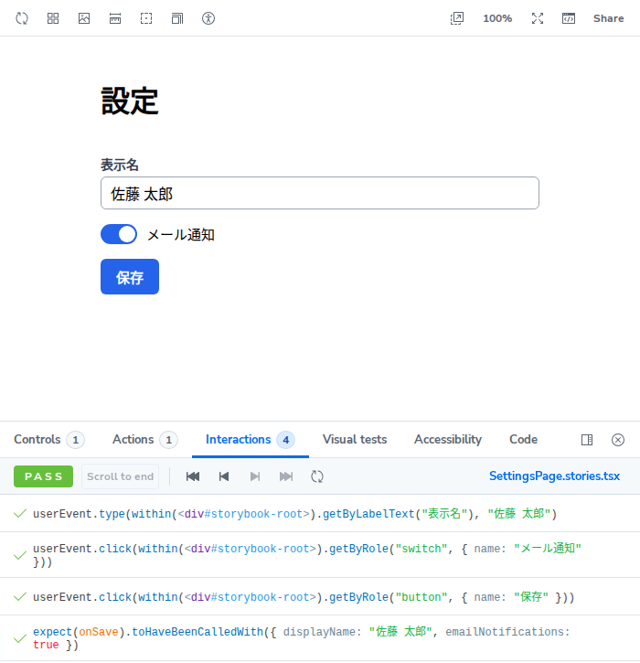

Storybook 11 beta には、AI 向けの機能としてスキル7本と AGENTS.md の Storybook 節が入りました。これを入れると、Claude Code は画面を書く前に今あるコンポーネントの説明を引き、作った画面のストーリーと操作のテストまで書いて回します。入れていないプロジェクトに同じ依頼を出したときは、画面のファイル1つだけでした。

AI に画面を作らせると、入力前・入力済み・保存したときの動きは、人がアプリを触って確かめることになります。状態ごとのストーリーとテストが一緒に残れば、確かめる場所が Storybook にまとまります。

参考動画は記事の最後に紹介しています。

## 環境

- Storybook 11.0.0-beta.3（npm の `next`。同じ日の `latest` は 10.6.8）。公式ブログは 11 の安定版を12月の目標としています
- Claude Code 2.1.329・モデル claude-opus-5-5（`--model` を付けない既定のまま）
- React 19・Vite 8.3.8・TypeScript 7.0.2（create-vite 9.3.4 の雛形のまま）
- Node v22.22.1・Linux（aarch64）
- 確認日は 2026-11-20。コンポーネント3つの小さなメモアプリで、条件ごとに2回ずつ頼んだ結果です

## 完成形

11 beta の Storybook が入っているプロジェクトなら、足すのは1行です。

```bash
npx storybook@next automigrate skills
```

新しく入れるときは、`npm create storybook@next` の途中で次の問いが出ます。既定は Yes です。

```text
◆  Do you want AI features, like skills and prompts, in your Storybook?
│  ● Yes / ○ No
```

（AI 向けの機能、スキルやプロンプトを Storybook に入れますか？）

どちらの入れ方でも、AGENTS.md に次の節が入ります。

```markdown:AGENTS.md
<!-- BEGIN:storybook-skills -->
<!-- Storybook updates this section on upgrade. Remove both markers to keep your own edits. -->

## Storybook

For every change to how the UI looks (you create, change, or delete a component, story, style, theme, or design token), follow these steps in order. Each step has a Storybook skill. First invoke the skills of all the steps, before you edit any file. Then follow each skill at its step.

1. `component-docs`: look up the components to reuse, with their props and usage examples, before you edit any file. Also when the user asks about a component's props, API, or usage.
2. `write-stories`: every component you create or change gets stories.
3. `test-stories`: run the story tests after every change, the way this skill says, never with a `package.json` test script, and fix what fails. Also when the user asks to run or fix story tests.
4. `ui-review`: publish a review that shows the user what changed, as your last step. Also when the user asks to see components or stories.

<!-- END:storybook-skills -->
```

和訳: UI の見た目を変えるたび（コンポーネント・ストーリー・スタイル・テーマ・デザイントークンを作る、変える、消す）、次の段を順に踏む。各段に Storybook のスキルがある。ファイルを編集する前に、全段のスキルを開く。そのうえで、各段でそのスキルに従う。（印の下のコメント: Storybook はアップグレードのたびにこの節を更新する。自分の編集を残すなら印を両方消す）

1. `component-docs`: 編集の前に、使い回すコンポーネントを props と使用例つきで引く。コンポーネントの props・API・使い方を聞かれたときも
2. `write-stories`: 作ったコンポーネント・変えたコンポーネントには、すべてストーリーを書く
3. `test-stories`: 変更のたびに、このスキルの方法でストーリーのテストを回す。`package.json` の test スクリプトでは回さない。落ちたら直す。テストを回す・直すよう頼まれたときも
4. `ui-review`: 最後の段で、変えた所を見せるレビューを出す。コンポーネントやストーリーを見たいと頼まれたときも

あとは、いつもどおり画面を頼みます。依頼文に Storybook やコンポーネントの話は書いていません。

```text
設定画面のページを1枚作ってください。表示名の入力と、メール通知のオン・オフを置いて、下に保存のボタンを置いてください。保存を押したら、いまは console.log で値を出すだけで構いません。
```

| | AI 向けの機能なし | AI 向けの機能あり |
|---|---|---|
| 使ったコンポーネント | 既存の Button・TextField・Switch | 既存の Button・TextField・Switch |
| 増えたファイル | `SettingsPage.tsx` | `SettingsPage.tsx`・`SettingsPage.stories.tsx` |
| ストーリーのテスト | 回していない（`npm run build` と lint だけ） | 回して全件通過 |

## 1. AI 向けの機能で何が入るか

`automigrate skills` でも init の Yes でも、入る物は同じでした。両方で作ったプロジェクトを比べて、差分はありません。

- スキル7本（`storybook-init`・`storybook-setup`・`storybook-upgrade`・`component-docs`・`write-stories`・`test-stories`・`ui-review`）。`.claude/skills/` と `.agents/skills/` の両方に同じ物
- `skills-lock.json`
- AGENTS.md の Storybook 節（完成形の13行）
- 同じ節を CLAUDE.md にも追記

CLAUDE.md への追記は、CLAUDE.md が AGENTS.md を読み込んでいないときの動きです。Claude Code が AGENTS.md を読まない構成でも、節が文脈に入ります。`package.json` と `.storybook/main.*` は、`automigrate skills` の前後で変わりませんでした。

:::note alert
TypeScript 7 のプロジェクトでは、`npx storybook ...` を打つたびに TypeScript 7 の警告が出ます。直すなら `typescript@^6` を devDependencies に入れるか、TypeScript 7 と 6 を並べて入れます。この記事の確認は TypeScript 7.0.2 のまま進めました。次の節の props は、非推奨の `react-docgen`（Storybook 12 で廃止予定）経由で読まれています。
:::

## 2. AI が編集の前に読むコンポーネントの説明を、手で出す

1段目の `component-docs` が使うのは、次の2つのコマンドです。どちらも Storybook の開発サーバーを起動していない状態で動きました。4 の `test run` も同じです。

```bash
npx storybook tools docs list
```

```text
# Components

- Button (components-button): アプリ共通のボタン。variant で見た目を、loading で処理中を表す。
- Switch (components-switch): オン・オフを切り替えるスイッチ。role="switch" で支援技術にも伝わる。
- TextField (components-textfield): 見出し付きの1行テキスト入力。label と input を結ぶ。
```

```bash
npx storybook tools docs show --id components-button
```

````text
# Button

ID: components-button

アプリ共通のボタン。variant で見た目を、loading で処理中を表す。

## Props

```
export type Props = {
  /** 見た目の種類。primary は画面の主な操作、secondary は補助の操作、danger は削除など取り消せない操作 */
  variant?: 'primary' | 'secondary' | 'danger' = 'primary';
  /** 大きさ */
  size?: 'sm' | 'md' = 'md';
  /** 処理中。押せなくなり、文字の前に回転する印が出る */
  loading?: boolean = false;
  /**  */
  children: ReactNode;
  type?: any = 'button';
}
```

## Stories

### Primary

Story ID: components-button--primary

```
import { Button } from './Button';
import { fn } from 'storybook/test';

const Primary = () => <Button onClick={fn()} variant="primary">ボタン</Button>;
```
````

Secondary と Danger のコードが続き、残りの Small・Disabled・Loading は ID の一覧だけです。そちらのコードは `npx storybook tools docs show-story --storyId <id>` で出ます。

説明の文は、コンポーネントの export の上に書いた JSDoc そのものです。props の説明も、props に付けた JSDoc から来ています。`component-docs` のスキルの本文は、`docs show` が書いている props だけを使うよう指示しています。重複を作らず今ある物を使い回すこと、ソースや `node_modules` はコマンドで何も出ないときだけ読むことも書かれています。

## 3. 同じ依頼を、機能なし・ありで2回ずつ頼む

材料はメモアプリです。コンポーネントは Button・TextField・Switch の3つで、それぞれ `src/components/<名前>/` に本体・CSS・ストーリーを置き、`src/components/index.ts` で束ねています。既存の画面 `HomePage` が Button と TextField を使っています。CLAUDE.md は、開発サーバーとビルドのコマンドを書いた2行だけです。

2つのプロジェクトの差は AI 向けの機能の有無だけです。機能なしは init の問いで No を選び、機能ありはそこへ `automigrate skills` で足しました。Storybook 本体と3つのコンポーネントのストーリーは、両方にあります。

| 回 | AI 向けの機能 | 使ったコンポーネント | 増えたファイル | 書いたストーリー | かかった時間 |
|---|---|---|---|--:|--:|
| 1 | なし | 既存の3つ | `SettingsPage.tsx` | 0 | 23.9秒 |
| 2 | なし | 既存の3つ | `SettingsPage.tsx` | 0 | 20.9秒 |
| 3 | あり | 既存の3つ | `SettingsPage.tsx`・`.stories.tsx` | 3 | 計れず |
| 4 | あり | 既存の3つ | `SettingsPage.tsx`・`.stories.tsx` | 4 | 99.3秒 |

4回とも、画面の3行目は同じ import でした。新しいボタンのファイルも、素の `<button>` も出ていません。

```tsx:src/pages/SettingsPage.tsx
import { Button, Switch, TextField } from '../components';
```

公式ブログは、文脈が無いとエージェントは今あるコンポーネントを作り直し、API を推測し、大事な状態や操作を落とす、と書いています。コンポーネント3つのこのアプリでは、機能なしでも作り直しは起きませんでした。機能なしの2回は、`cat src/components/*/*.tsx` でコンポーネントのソースを読んでから書いています。機能ありの2回は、書く前に4つのスキルを開き、`docs list` と3つのコンポーネントの `docs show` を打ちました。そのあと `App.tsx` などのソースも読んでいます。

違いが出たのは、ストーリーと画面の形です。機能ありの2回は、ページが最初の値と保存の処理を props で受け取る形になりました。

```tsx:src/pages/SettingsPage.tsx（機能ありの1回目・抜粋）
export interface SettingsPageProps {
  /** 最初に表示する値 */
  initialValues?: SettingsValues;
  /** 保存を押したときに呼ばれる。いまは既定で console.log に出すだけ */
  onSave?: (values: SettingsValues) => void;
}

export function SettingsPage({
  initialValues = DEFAULT_VALUES,
  onSave = (values) => console.log('save settings', values),
}: SettingsPageProps) {
```

機能なしの2回のページは props を持たず、`console.log` を中に直接書いています。ストーリーから props で値を渡せる形になったのは、機能ありの側だけです。

## 4. 書かれたストーリーとテスト

機能ありの1回目が書いたストーリーです。入力前・入力済み・保存の3つで、それぞれに `play` 関数が付いています。

```tsx:src/pages/SettingsPage.stories.tsx
import preview from '../../.storybook/preview';

import { expect, fn } from 'storybook/test';

import { SettingsPage } from './SettingsPage';

const meta = preview.meta({
  component: SettingsPage,
  parameters: {
    layout: 'fullscreen',
  },
  args: { onSave: fn() },
});

export const Empty = meta.story({
  play: async ({ args, canvas }) => {
    await expect(canvas.getByLabelText('表示名')).toHaveValue('');
    await expect(canvas.getByRole('switch', { name: 'メール通知' })).not.toBeChecked();
    await expect(args.onSave).not.toHaveBeenCalled();
  },
});

export const Filled = meta.story({
  args: {
    initialValues: { displayName: '山田 花子', emailNotifications: true },
  },
  play: async ({ canvas }) => {
    await expect(canvas.getByLabelText('表示名')).toHaveValue('山田 花子');
    await expect(canvas.getByRole('switch', { name: 'メール通知' })).toBeChecked();
  },
});

export const SaveChanges = meta.story({
  play: async ({ args, canvas, userEvent }) => {
    await userEvent.type(canvas.getByLabelText('表示名'), '佐藤 太郎');
    await userEvent.click(canvas.getByRole('switch', { name: 'メール通知' }));
    await userEvent.click(canvas.getByRole('button', { name: '保存' }));
    await expect(args.onSave).toHaveBeenCalledWith({
      displayName: '佐藤 太郎',
      emailNotifications: true,
    });
  },
});
```

書き方は、プロジェクトの `.storybook/preview` から `preview.meta` と `meta.story` を使う形（CSF Factories）です。既存の3つのコンポーネントのストーリーと同じ形にそろっています。2回目は、保存を押すまで `onSave` が呼ばれないことを確かめるストーリーを足した4つでした。


*保存のストーリー（Save Changes）の Interactions タブ。play 関数の操作4つが通っている*

テストは、作ったストーリーの ID を渡して回しています。

```bash
npx storybook tools test run --stories '[{"storyId":"pages-settingspage--empty"},{"storyId":"pages-settingspage--filled"},{"storyId":"pages-settingspage--save-changes"}]'
```

```text
## Passing Stories

- pages-settingspage--empty
- pages-settingspage--filled
- pages-settingspage--save-changes

## Result

Passed: 3 component tests passed.
Accessibility: 3 stories checked, no violations.
```

`--stories` を外すと、全部のストーリーが回ります。1回目は終える前に全体を1回回し、前からある Switch の disabled 状態で、コントラスト不足を拾いました。

```text
## Accessibility Violations

### components-switch--disabled - color-contrast
（中略）
  Element has insufficient color contrast of 3.94 (foreground color: #808080, background color: #ffffff, font size: 11.3pt (15px), font weight: normal). Expected contrast ratio of 4.5:1

## Result

Passed: 15 component tests passed.
Accessibility: 15 stories checked; 14 without violations; 1 with violations reported as warnings, which do not fail the run.
```

コントラスト比は 3.94 で、基準の 4.5 に届いていません。最後の行のとおり、この違反は警告の扱いで、テストは落ちません。

AI は色を変えずに、最後の返事の「決めてほしいこと」に3つの案を並べました。文字色を `#767676` 程度に濃くする、文字色は通常のままにしてスイッチ本体だけ薄くする、今のままにする、の3つです。`test-stories` の公式 docs は、コントラストのような見た目の問題ではデザインを変えず、問題を説明して2〜3の選択肢を出し、人に選ばせると書いています。

4段目の `ui-review` では、AI は `npx storybook tools review create` でレビューを作り、返事の最後にレビューのページ（`http://127.0.0.1:6006/?path=/review/`）へのリンクを付けました。1回目のレビューに載ったのは、作ったストーリー3つです。このページは開発サーバーの上で開くので、AI は開発サーバーが動いていないのを確かめてから `npm run storybook` で立てています。

:::note alert
`claude -p`（非対話）で頼むと、`ui-review` の段で AI が立てた開発サーバーが残りました。返事は出終わっているのに、`claude -p` のプロセスが終わりません。スクリプトから回すときは、終わったあとに開発サーバーを止める手当てが要ります。
:::

<details><summary>頼んだときの条件</summary>

- `claude -p` に `--output-format stream-json --verbose` を付けて非対話で実行
- 権限は `--permission-mode acceptEdits`。`Bash` と `Skill` を許可し、`WebFetch`・`WebSearch` は禁止（外の docs を読ませない）
- MCP サーバー・個人の hooks・プラグイン・個人の CLAUDE.md は読ませない
- 3回目の時間は、上の開発サーバーが残って計れませんでした
- 試したのはコンポーネント3つのアプリ・React・Claude Code の claude-opus-5-5 だけです。大規模なコンポーネントライブラリ、Vue など他のフレームワーク、他のエージェントやモデルでは試していません。依頼文に「ストーリーも書いて」と足す形も試していません

</details>

## 節を入れたくないときと、対象のフレームワーク

公式 docs では、AGENTS.md の節を消すと、エージェントはスキルを、名前で頼まれたときと、仕事に合うと判断したときにだけ使います。ストーリーを書かせたい場面で `write-stories` を名前で頼む使い方になります。

4段の手順は React・Vue 3・Angular・Svelte・Web Components が対象です。3段目の `test-stories` は Vitest addon が要り、Vitest addon には Vite のビルダーが要ります。

## まとめ

| 症状 | 対処 |
|---|---|
| AI に作らせた画面に、状態ごとのストーリーもテストも残らない | 11 beta で `npx storybook@next automigrate skills`。新しく入れるなら init の AI features の問いで Yes |
| AI にコンポーネントの何が渡っているか分からない | `npx storybook tools docs list` と `docs show --id <id>` で、編集の前に AI が読む説明を出す |
| `docs list` の説明が空 | コンポーネントの export の上と props に JSDoc を書く。`docs show` はそこから説明を出す |
| 作ったストーリーだけテストしたい | `npx storybook tools test run --stories '[{"storyId":"<id>"}]'`。全部なら `--stories` を外す |
| 既存コンポーネントでコントラストの警告が出る | テストは落ちない（警告扱い）。AI はデザインを変えずに案を出すので、人が選ぶ |
| AGENTS.md の節を自分の言葉に書き換えたい | `BEGIN`・`END` の印を両方消す。残すとアップグレードで書き直される |

## 参考リンク

- [Storybook 11 beta（公式ブログ・2026-11-09、11-16 更新）](https://storybook.js.org/blog/storybook-11-beta/)
- [Connect to AI（スキルと AGENTS.md の節・入れ方・対象のフレームワーク）](https://github.com/storybookjs/storybook/blob/next/docs/ai/connect.mdx)
- [component-docs（コンポーネントの説明を引くスキル）](https://github.com/storybookjs/storybook/blob/next/docs/ai/skills/component-docs.mdx)
- [test-stories（ストーリーのテストを回すスキル）](https://github.com/storybookjs/storybook/blob/next/docs/ai/skills/test-stories.mdx)

## 参考動画

<iframe width="560" height="315" src="https://www.youtube.com/embed/W3bl90pFSDo" title="YouTube video player" frameborder="0" allowfullscreen></iframe>
