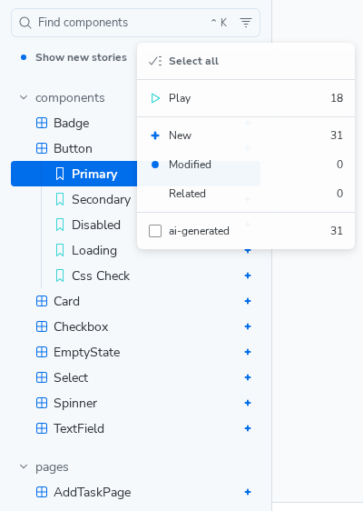

Storybook の無い React＋Vite のアプリに、`npm create storybook@next` で 11 beta を入れました。続けて Claude Code に storybook-setup スキルを1文で頼むと、既存コンポーネント8つと画面1枚のストーリーが9ファイルできました。テスト31件が通り、アプリのコードは1行も変わっていません。足されたのはストーリーと、`.storybook/preview.tsx` の4行だけです。

既存のアプリに Storybook を後から入れると、init が置くのは例のストーリー（Button・Header・Page）です。既存コンポーネントのストーリーは、1本ずつ書くところから始まります。

参考動画は記事の最後に紹介しています。

## 環境

- Storybook 11.0.0-beta.3（`npm create storybook@next` を打った時点の `next`）。公式ブログは 11 の安定版を12月の目標としています
- Claude Code 2.1.330・モデル claude-opus-5-5
- React 19.3.1・Vite 8.3.8・TypeScript 6.0.3・Vitest 4.1.11
- Node v22.22.1・npm 9.2.0・Linux（aarch64）
- 確認日は 2026-11-21。setup を頼んだのは1回です

## 完成形

```bash
npm create storybook@next -- --no-dev
```

途中の問いは3つで、すべて既定のまま Enter で進めました。オンボーディング・AI 向けの機能・Playwright の Chromium の導入が、どれも Yes です。`--no-dev` は、終わったあとに Storybook の開発サーバーを立ち上げないためのフラグです。

storybook-setup は、AI 向けの機能の問いで Yes にすると入るスキルの1つです。終わったら、Claude Code にこの1文を渡します。

```text
storybook-setup スキルを使って、このアプリに Storybook を整えてください。
```

約100秒で、次の変更ができました（init の例の削除は省略）。

```text
 .storybook/preview.tsx                           |   4 +
 src/components/Badge/Badge.stories.tsx           |  19 ++
 src/components/Button/Button.stories.tsx         |  45 +++
 src/components/Card/Card.stories.tsx             |  26 ++
 src/components/Checkbox/Checkbox.stories.tsx     |  31 ++
 src/components/EmptyState/EmptyState.stories.tsx |  26 ++
 src/components/Select/Select.stories.tsx         |  24 ++
 src/components/Spinner/Spinner.stories.tsx       |  23 ++
 src/components/TextField/TextField.stories.tsx   |  29 ++
 src/pages/AddTaskPage.stories.tsx                |  42 +++
```

## 1. 開始状態のアプリを用意する

サンプルの `main` が、Storybook を入れる前の状態です。

```bash
git clone https://github.com/zun-tools/storybook-sample.git
cd storybook-sample
npm install
npm run dev
```

中身は小さなタスク管理のアプリです。`src/components/` にあるコンポーネントは8つです（Badge・Button・Card・Checkbox・EmptyState・Select・Spinner・TextField）。画面は `src/pages/AddTaskPage.tsx` の1枚だけです。データは `src/api/tasks.ts` が localStorage に出し入れし、300ms 待ってから返します。

各コンポーネントの export の上には、用途を1文で書いた JSDoc があります。公式の Best practices の例にならって書いたものです。

```tsx:src/components/Button/Button.tsx（抜粋）
/** 画面の中で操作を実行するボタン。別の画面への移動には使わない。 */
export function Button({ variant = 'primary', loading = false, disabled, type = 'button', children, ...rest }: ButtonProps) {
```

:::note alert
create-vite 9.3.4 の React＋TypeScript の雛形は TypeScript 7.0.2 です。このままだと Storybook 11.0.0-beta.3 は警告を出します。コンポーネントの型を読むコンパイラ API が、TypeScript 7 には無いためです。動きは、非推奨の `react-docgen` に切り替わります。サンプルは `typescript` を `~6.0.3` にしてあり、init のあとの `npx storybook tools docs list` に警告は出ませんでした。
:::

## 2. Storybook 11 beta を入れる

サンプルのフォルダで init を実行します。

```bash
npm create storybook@next -- --no-dev
```

2つ目の問いが、AI 向けの機能です。

```text
◆  Do you want AI features, like skills and prompts, in your Storybook?
│  ● Yes / ○ No
```

（AI 向けの機能、スキルやプロンプトを Storybook に入れますか？）

Yes のまま進めると、Storybook 本体に加えて次の物が入りました。

- `package.json` に `storybook`・`build-storybook` のスクリプトと、`storybook`・`@storybook/react-vite`・`@storybook/addon-vitest`・`@storybook/addon-a11y`・`@storybook/addon-docs`・`vitest`・`playwright` などの devDependencies
- `.storybook/main.ts`・`.storybook/preview.tsx`、`vite.config.ts` にストーリーのテスト用の Vitest プロジェクト（名前は `storybook`）
- スキル7本を `.claude/skills/` と `.agents/skills/` の両方に。`skills-lock.json`
- AGENTS.md（新規）と CLAUDE.md に、印 `<!-- BEGIN:storybook-skills -->`〜`<!-- END:storybook-skills -->` で囲んだ Storybook の節
- 例のストーリー `src/stories/`（Button・Header・Page と `Configure.mdx`）

init の最後は、AI に貼る1文の案内で終わります。

```text
└  Done!  Review skills before use; they run with full agent permissions.
（中略）
◇  To finalize setting up with AI, paste this prompt to your AI agent:

│  Run `npx storybook skills setup` and follow its instructions precisely.
```

（使う前にスキルを確かめてください。スキルはエージェントの全権限で動きます。／AI での設定の仕上げに、このプロンプトを AI エージェントに貼ってください: `npx storybook skills setup` を実行し、その指示どおりに進めて）

完成形の頼み方は、公式 docs の setup のページにある形に合わせました。Storybook が入っているなら、storybook-setup スキルを使うよう頼む形です。

## 3. Claude Code に setup を頼む

公式 docs では、setup スキルはまずアプリのエントリポイント・プロバイダ・グローバル CSS・データ取得の方法を読みます。そのうえでストーリーを最大10ファイル書いてテストを回し、init の例を消します。前からあるストーリー・コンポーネント・設定には足すだけで、消したり書き換えたりはしません。

実際に変わった既存のファイルは `.storybook/preview.tsx` の1つで、足されたのは次の4行です。

```diff:.storybook/preview.tsx
 import { definePreview } from '@storybook/react-vite'
 import addonA11y from '@storybook/addon-a11y';
 import addonDocs from '@storybook/addon-docs';
+import { sb } from 'storybook/test';
+import '../src/index.css';
+
+sb.mock(import('../src/api/tasks.ts'), { spy: true });
```

`../src/index.css` で、ストーリーの画面にアプリ全体の CSS が当たります。`sb.mock(..., { spy: true })` は、データの読み書きをするモジュールを、ストーリーから差し替えられる形にする行です。AI の返事では、これでタスク追加の画面のストーリーが localStorage に書き込まなくなる、と説明していました。通信も現在日時への依存も無いので、MSW と MockDate は入れていません。

画面のストーリーは、その口を使って `createTask` を偽物にしています。

```tsx:src/pages/AddTaskPage.stories.tsx（抜粋）
const meta = preview.meta({
  component: AddTaskPage,
  tags: ['ai-generated'],
  beforeEach() {
    mocked(createTask).mockImplementation(async (input) => ({
      ...input,
      id: 't1',
      done: false,
      createdAt: '2026-11-21T09:00:00.000Z',
    }));
  },
});

export const EmptyTitleError = meta.story({
  play: async ({ canvas, userEvent }) => {
    await userEvent.click(canvas.getByRole('button', { name: '追加' }));
    await expect(await canvas.findByText('タイトルを入れてください')).toBeVisible();
    await expect(createTask).not.toHaveBeenCalled();
  },
});
```

ストーリーは初期表示・タイトル未入力のエラー・入力して送信の3つでした。

もう1つ、Button のストーリーに `CssCheck` が1本足されています。setup スキルが全体で1本だけ書くよう決めているストーリーで、CSS が本当に読み込まれたかを計算済みのスタイルで確かめます。

```tsx:src/components/Button/Button.stories.tsx（抜粋）
export const CssCheck = meta.story({
  args: { children: '送信' },
  play: async ({ canvas }) => {
    const button = canvas.getByRole('button', { name: '送信' });
    // Button.css: .btn--primary { background: #1d4ed8 } — fails if the component CSS did not load.
    await expect(getComputedStyle(button).backgroundColor).toBe('rgb(29, 78, 216)');
    // index.css: body { font-family: system-ui, sans-serif } — fails if the global CSS did not load.
    await expect(getComputedStyle(button.ownerDocument.body).fontFamily).toContain('system-ui');
  },
});
```

コメントの和訳: Button.css の主ボタンの背景色。コンポーネントの CSS が読み込まれていなければ失敗する。／index.css の body のフォント。全体の CSS が読み込まれていなければ失敗する。

ストーリーの書き方は、init が作った `preview.tsx`（`definePreview`）に合わせた `preview.meta`・`meta.story` の形（CSF Factories）です。setup の手順書は `Meta`・`StoryObj` の形の例と `npx vitest` でのテストを挙げていました。AI は返事で、CLAUDE.md の Storybook 節を優先してこの形で書き、テストは `npx storybook tools test run` で回したと断っています。init の例の `src/stories/` は、AI が `git rm` で消しました（ステージ済みで、コミットはしていません）。

## 4. `ai-generated` の印を確かめて外す

公式 docs では、setup は書いたストーリーのファイルに `ai-generated` の印を付けます。テストが通らなかったファイルには、さらに `needs-work` が残ります。中身を確かめたら、ファイルごとに `ai-generated` を外すのは人の仕事です。

今回は9ファイルすべてが `tags: ['ai-generated']` で、`needs-work` は0でした。


*サイドバーの絞り込みのメニュー。ai-generated の印が付いたストーリーは31本*

:::note alert
`ai-generated` の印は、サイドバーのストーリー名の横には出ません。どれに付いているかは、検索欄の右の絞り込みメニューで見ます。
:::

外すときは meta の1行を書き換えます。

```diff:src/components/Button/Button.stories.tsx
-  tags: ['ai-generated'],
+  tags: [],
```

9ファイルとも外したあとも、テストは31件すべて通りました。サンプルの git のタグ `step2-setup` は、印を外したあとの状態です。

## 5. ストーリーのテストを回す

init が `vite.config.ts` に作った Vitest プロジェクトで回します。

```bash
npx vitest --project storybook run
```

テストは Playwright の Chromium で動きます。init の3つ目の問いで Yes にしていれば、もう入っています。No にしたときや、サンプルの git のタグを clone して試すときは、先に `npx playwright install chromium` を打ちます。

31件が通りました。`npx storybook tools test run` でも、同じストーリーのテストを回せます。

:::note alert
ストーリーが増えた直後の最初の Vitest で、各ストーリーファイルの最初のテストだけが失敗することがあります。ログに `Re-optimizing dependencies`（依存の最適化のやり直し）が出ている実行です。同じコマンドをもう一度走らせると、全件通りました。
:::

## 6. AI が次に読むコンポーネントの一覧を確かめる

setup のあと、エージェントが画面を作る前に引くコンポーネントの一覧は次のとおりです。

```bash
npx storybook tools docs list
```

```text
# Components

- Badge (components-badge): 状態や種類を短い言葉で示す札。押せない。
- Button (components-button): 画面の中で操作を実行するボタン。別の画面への移動には使わない。
- Card (components-card): 関係のある内容をひとまとまりに囲む枠。
- Checkbox (components-checkbox): 1つの項目をオン・オフするチェックボックス。
- EmptyState (components-emptystate): 見せる内容が無いときに、その理由と次の操作を示す。
- Select (components-select): 見出しつきの選択欄。選べる項目が少なく、決まっているときに使う。
- Spinner (components-spinner): 終わるのを待っている間に出す回転の印。
- TextField (components-textfield): 見出しつきの1行の文字入力。
- AddTaskPage (pages-addtaskpage)
```

説明の文は、コンポーネントの上の JSDoc そのままです。AddTaskPage に説明が無いのは、画面のコンポーネントの上に JSDoc を書いていないためです。公式の Best practices には次の1文があります。

> The better you document your components, the better your agent reuses them.

（コンポーネントをよく説明するほど、エージェントはよく使い回す）

同じページは、用途をコンポーネントの export の上の JSDoc に書くよう勧めています。例に挙がっている文は次のとおりです。

> Button is used for user interactions that do not navigate to another route.

（Button は、別のルートへ移動しない操作に使う）

:::note alert
setup が書いたストーリーには `autodocs` のタグが無く、コンポーネントの Docs のページはできませんでした。JSDoc の用途の文が出るのは、`docs list`・`docs show` の出力です。
:::

サンプルの git のタグ `step3-list` 以降には、この状態から一覧画面を頼んだ結果と、アプリにつないだ結果が入っています。

## 使った道具について

Storybook は、コンポーネントや画面を状態ごとのストーリーとして並べて表示・テストする OSS です。ライセンスは MIT で、保守は Chromatic 社です。Storybook 自体は無料で、AI を動かす分はお使いの AI の契約によります。AI に setup を任せられるのは、Vite で動く3つです。React（react-vite・nextjs-vite・tanstack-react）・Vue 3・Angular が対象です。

## まとめ

| 症状 | 対処 |
|---|---|
| 既存アプリに Storybook を入れても、既存コンポーネントのストーリーが無い | init の AI features で Yes → 「storybook-setup スキルを使って、このアプリに Storybook を整えてください。」 |
| init のあとに TypeScript 7 の警告が出る | `typescript` を `~6.0.x` にする |
| AI が書いたストーリーがどれか分からない | サイドバーの絞り込みで `ai-generated`。確かめたら meta の `tags` から外す |
| AI が書いた直後のテストで、各ファイルの最初の1件だけ落ちる | 同じ `npx vitest --project storybook run` をもう一度 |
| コンポーネントの Docs のページが無い | setup のストーリーには `autodocs` が無い。AI が読む説明は `npx storybook tools docs list` で見る |

## 参考リンク

- [setup（既存アプリにストーリーを整えるスキル・ai-generated の印）](https://github.com/storybookjs/storybook/blob/next/docs/ai/skills/setup.mdx)
- [Connect to AI（入れ方・対象のフレームワーク）](https://github.com/storybookjs/storybook/blob/next/docs/ai/connect.mdx)
- [Best practices（コンポーネントの用途を JSDoc に書く）](https://github.com/storybookjs/storybook/blob/next/docs/ai/best-practices.mdx)
- [サンプル: zun-tools/storybook-sample（開始状態・頼んだ文・段ごとの git のタグ）](https://github.com/zun-tools/storybook-sample)

## 参考動画

<iframe width="560" height="315" src="https://www.youtube.com/embed/T6d91P0-KBM" title="YouTube video player" frameborder="0" allowfullscreen></iframe>

---

作った画面のストーリーとテストまで書かせる記事: https://qiita.com/zundamon-tools/private/6447afe17e6ba9023004
